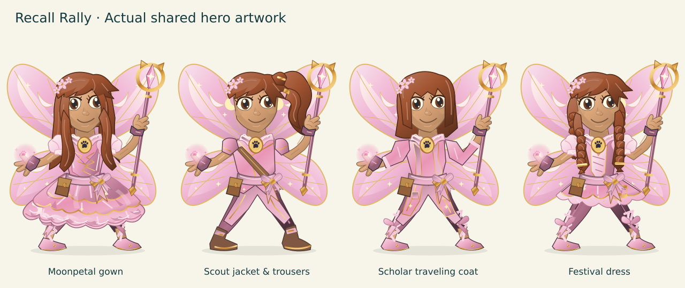

# Fair answers and character polish

Typed Quick Recall answers now receive conservative local matching. Existing multiple-choice scoring, clocks, question IDs, sources, learning profiles, browser storage keys and Adventure saves remain in place.

- High confidence: exact accepted answers with harmless punctuation/capitalization, or a single clear transposition in a long word. Numeric expressions, chemical symbols and units retain stricter comparisons.
- Intermediate confidence: one plausible spelling error. The student sees their original response and the proposed accepted answer before any score or journal attempt is recorded. They can confirm, edit/retry, or count a miss. Confirmed attempts retain the original response in the journal.
- Low confidence: count a miss using the existing solo explanation/team handoff. Known competing academic terms, distractors, changed numbers, units, formulas and negation do not receive fuzzy credit. Case and punctuation remain exact when they distinguish choices; spelling questions do not receive typo credit. Spoken answers judged by a reader retain their existing controls. Device dictation entered into the answer field uses the same matcher; this update adds no microphone service.

The matcher is deliberately conservative. It is spelling assistance, not a semantic language model. Unlisted synonyms and uncertain dictation may still need the existing reader/self-judging route. No online service receives student answers.

The shared SVG hero renderer adds slow breathing, occasional blinking and a subtle magic glow. Reduced-motion disables these additions; combat poses and Librarian movement suppress the ambient motion. Small creator thumbnails stay still. Fairy scout clothing now has trousers and an asymmetric field jacket; scholar clothing has a narrow open traveling coat over trousers. Mage and bard dresses remain available. The Starclaw preset uses a ponytail and short bard tunic. Saved selections are never reset.

Countdown bars follow the existing Adventure and Librarian clocks. Low time changes the bar color alongside the numeric countdown without flashing. Adventure pause freezes its clock and hides the bar with the existing pause screen; untimed Adventure has no bar. Quick Recall timing and Written Practice clocks are unchanged. These are practice-game indicators, not claims about official competition timing.

The artwork preview uses the actual game renderers, with identical colors to make silhouette differences visible. It is a still preview, not a browser layout or animation capture.

## Review path

1. Open Quick Recall, buzz, and type a plausible typo such as `photosyntesis` for a photosynthesis question. Verify the confirmation, retry and scoring paths.
2. In Build your hero, compare fairy scout, scholar, mage and bard outfits. Check the selected hero in Adventure, Science Lab and The Librarian.
3. Play a timed Adventure question; pause and resume. Compare No timer. In The Librarian, watch its existing 16-second timer bar.

## Validation

Local passes: answer-recognition tests (all 1,550 canonical answers and aliases plus spelling/academic counterexamples), home launcher, Adventure saves, bank integrity, ten worlds, Adventure effects, Science Lab, Librarian v4 smoke, artwork manifest and inline JavaScript syntax. Existing archived Librarian v1–v3 tests refer to obsolete buzzer/pose APIs and fail on the unchanged baseline too; they are outside the current build checks.

Local interactive browser execution is unavailable: the runtime blocks Chrome's process sockets. `tests/player-experience-browser.test.cjs` and the Player experience workflow cover 1366×768, 1024×768, 820×1180 and 390×844, confirmation focus/touch/scoring/journal, choices, timed/pause/untimed behavior, shared hero rendering and reduced motion. The workflow uploads actual screenshots. The four-viewport interaction suite passed in GitHub Actions run 40879083133. Subsequent commits must pass again. Inspect the uploaded screenshots before release. Physical iPad, mobile Safari, dictation and sustained-device performance are not verified here.

## Deferred

Adaptive timing requires a separate learning/accessibility evaluation and explicit optional controls. PixiJS remains deferred; no renderer migration or dependencies were introduced. The next useful visual review is a physical iPad pass on the new silhouettes and idle movement.
