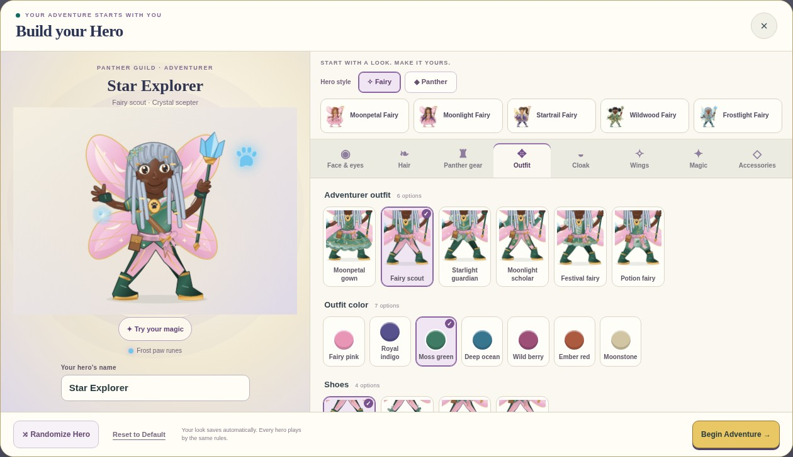
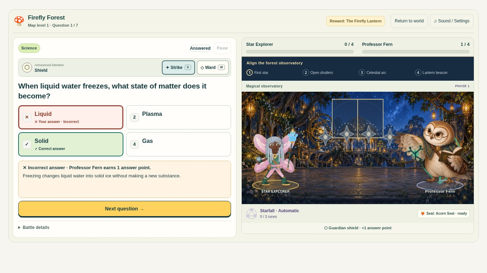

# Hero and guardian illustration review

Implemented on `feature/hero-guardian-character-art`, from `main` at `65d0953` after the ten-world upgrade merged. The work is integrated into the existing playable game and prepared as a draft PR.

## Review the game

Run `node scripts/build-standalone.cjs`, serve the complete `Ellery_Recall_Rally_Librarian_v4.html` locally, and choose **Rescue Rigby**. In **Build your Hero**, try both styles, a different face/skin/hair, outfit, hood, shoes, staff and magic. Start Mosswood, miss an answer, then answer correctly to see the guardian’s casting/reaction poses and the hero’s shoulder gesture. Finish four answer points to advance the same existing rescue.

The normal Amplify build also contains the complete upgrade. Raw source `index.html` requires the existing Librarian injection/copy step when reviewing all game modes.

## Changes

- Ten guardians now use thirty original painted character poses, with detailed fur, feathers, scales, crystal, fabric, leather and brass. Curious, casting and appreciative silhouettes share the same equipment and ground registration. Victory and defeat use friendly appreciative responses.
- A short dissolve connects authored guardian poses. Existing whole-figure recoil is disabled for those paintings, so the artwork’s anatomy supplies the gesture. Reduced motion switches directly to the selected pose.
- The shared hero has refined eyes/irises, facial volume, hair fibers, painted fabric shading and outfit-specific tailoring. All six outfits remain distinct in both styles.
- The hero’s sleeves, hands and gloves share a shoulder gesture during casting, with secondary cape movement. The equipped staff and existing spell-focus coordinates remain intact.
- Saved appearance values, color definitions, defaults, presets, grading, question banks, explanations, scoring, timers, seals, learning history, saves and sound preferences remain intact. The Librarian’s existing independent limb rig still controls its platform movement.
- Character art and materials are embedded in both static Amplify output and standalone HTML. No new runtime library, remote art request or animation timer was added.

The immutable customization-schema check covers every existing choice/color/default/preset. The previous 48 illustration hashes were intentionally refreshed because this task changes the shared artwork; their original saved appearance configurations are retained. Independent coverage checks every option, valid SVG references, no appearance mutation, actual creator selections, gameplay, reload and saved-profile round trips.

## Actual before/after gameplay

All captures below are screenshots of the functioning game or its actual character creator. No controls, scores, questions or characters were composited into them. Before captures use unchanged `main` at `65d0953`. The default comparisons use the same default look; later screenshots deliberately demonstrate creator-selected appearances. Questions still rotate normally.

| View | Before | After |
| --- | --- | --- |
| Default laptop creator | [Before](before-desktop-creator.jpg) | [After](after-desktop-creator.jpg) |
| Default laptop encounter | [Before](before-desktop-encounter.jpg) | [After](after-desktop-encounter.jpg) |
| Default phone creator | [Before](before-phone-creator.jpg) | [After](after-phone-creator.jpg) |
| Default phone encounter | [Before](before-phone-encounter.jpg) | [After](after-phone-encounter.jpg) |



### All six outfits, both styles

These are complete creator screenshots, with live controls and selectable clothing.

| Outfit | Fairy | Panther |
| --- | --- | --- |
| Mage | [Moonpetal gown](desktop-hero-fairy-mage.jpg) | [Moon mage](desktop-hero-panther-mage.jpg) |
| Ranger | [Fairy scout](desktop-hero-fairy-ranger.jpg) | [Forest ranger](desktop-hero-panther-ranger.jpg) |
| Knight | [Starlight guardian](desktop-hero-fairy-knight.jpg) | [Panther knight](desktop-hero-panther-knight.jpg) |
| Scholar | [Moonlight scholar](desktop-hero-fairy-scholar.jpg) | [Rune scholar](desktop-hero-panther-scholar.jpg) |
| Bard | [Festival fairy](desktop-hero-fairy-bard.jpg) | [Festival bard](desktop-hero-panther-bard.jpg) |
| Alchemist | [Potion fairy](desktop-hero-fairy-alchemist.jpg) | [Potion keeper](desktop-hero-panther-alchemist.jpg) |

[Customized Fairy creator](desktop-creator-customized.jpg) · [Hooded Panther creator on phone](phone-creator-customized.jpg).

### Every guardian in the playable encounter

Each row follows the actual sequence **question → wrong choice → guardian cast/explanation → correct choice → reaction**. The same run then earns four actual correct-answer points and the existing rescue seal.

| Guardian | Curious / question | Casting / mistake | Impressed / correct |
| --- | --- | --- | --- |
| Pippin | [Question](desktop-guardian-0-curious.jpg) | [Cast](desktop-guardian-0-casting.jpg) | [Reaction](desktop-guardian-0-reaction.jpg) |
| Professor Fern | [Question](desktop-guardian-1-curious.jpg) | [Cast](desktop-guardian-1-casting.jpg) | [Reaction](desktop-guardian-1-reaction.jpg) |
| Captain Compass | [Question](desktop-guardian-2-curious.jpg) | [Cast](desktop-guardian-2-casting.jpg) | [Reaction](desktop-guardian-2-reaction.jpg) |
| Quill | [Question](desktop-guardian-3-curious.jpg) | [Cast](desktop-guardian-3-casting.jpg) | [Reaction](desktop-guardian-3-reaction.jpg) |
| Maestro Moth | [Question](desktop-guardian-4-curious.jpg) | [Cast](desktop-guardian-4-casting.jpg) | [Reaction](desktop-guardian-4-reaction.jpg) |
| Flint | [Question](desktop-guardian-5-curious.jpg) | [Cast](desktop-guardian-5-casting.jpg) | [Reaction](desktop-guardian-5-reaction.jpg) |
| Tock | [Question](desktop-guardian-6-curious.jpg) | [Cast](desktop-guardian-6-casting.jpg) | [Reaction](desktop-guardian-6-reaction.jpg) |
| Lyra | [Question](desktop-guardian-7-curious.jpg) | [Cast](desktop-guardian-7-casting.jpg) | [Reaction](desktop-guardian-7-reaction.jpg) |
| Zephyr | [Question](desktop-guardian-8-curious.jpg) | [Cast](desktop-guardian-8-casting.jpg) | [Reaction](desktop-guardian-8-reaction.jpg) |
| Astra | [Question](desktop-guardian-9-curious.jpg) | [Cast](desktop-guardian-9-casting.jpg) | [Reaction](desktop-guardian-9-reaction.jpg) |



### Mobile, reunion and packaged build

Phone: [Pippin question](phone-guardian-0-curious.jpg), [cast](phone-guardian-0-casting.jpg), [reaction](phone-guardian-0-reaction.jpg); [Astra question](phone-guardian-9-curious.jpg), [cast](phone-guardian-9-casting.jpg), [reaction](phone-guardian-9-reaction.jpg). [Saved Panther reunion](phone-customized-reunion.jpg) and [offline reduced-motion response](phone-offline-reduced-response.jpg).

Tablet landscape: [creator](tablet-landscape-creator-customized.jpg), [question](tablet-landscape-guardian-0-curious.jpg), [final guardian reaction](tablet-landscape-guardian-9-reaction.jpg), [reunion](tablet-landscape-customized-reunion.jpg). Tablet portrait: [creator](tablet-portrait-creator-customized.jpg), [question](tablet-portrait-guardian-0-curious.jpg), [final reaction](tablet-portrait-guardian-9-reaction.jpg), [reunion](tablet-portrait-customized-reunion.jpg).

Laptop: [customized reunion](desktop-customized-reunion.jpg), [offline reduced-motion response](desktop-offline-reduced-response.jpg).

Actual Amplify command output, served locally: [first encounter](staged/staged-desktop-world-0-question.jpg), [restored Clockwork City](staged/staged-desktop-world-6-restored.jpg), [tenth-seal reunion](staged/staged-desktop-rescue-10.jpg).

## Verification performed

Automated **Chromium** tests at 1366×768 laptop, 1024×768 landscape tablet, 820×1180 portrait tablet and 390×844 phone. Phone answer choices use native touch taps. These are emulated viewports/touch capabilities, not physical-device tests.

| Check | Result |
| --- | --- |
| Complete character encounters | All ten guardians at all four sizes; all three painted poses decoded and selected by actual answers; four correct points and one seal per world |
| Academic records | Each full journey grades 50 real questions: 40 correct and 10 incorrect, with exactly 50 journal attempts. Offline rematch checks add their actual two attempts |
| Every appearance option | 266 independently rendered option variants across the two styles; original appearance objects and global preferences remain unchanged |
| Outfit/pose composition | 48 style × outfit × pose cases, valid SVG parsing, unique IDs and resolved paint/clip/use references |
| Visual outfit review | All twelve style/outfit combinations captured through the live creator; default and deliberately customized appearances reviewed |
| Gestures | Casting sleeve/hand movement observed independently of the hero fighter wrapper; guardian poses use authored anatomical changes; reduced motion retains clear selected poses |
| Saved identity | Creator-selected names, skin, silver locs, outfit, staff, magic and hood choices survive all ten worlds, final reunion, reload and offline play |
| Asset geometry | Thirty transparent frames decode; pose baselines, consistent per-character scale, alpha corners, bounds within the playable stage, SHA-256 and byte budgets pass |
| Existing game contracts | Original 22 entrypoint/gameplay function hashes, appearance schema, save source and complete Librarian source remain unchanged; existing 140 tactical cases and ten-world tests pass |
| Amplify | Every command from `amplify.yml` passes in isolated staging; a complete ten-world run, defeat/recovery/save and offline rematch play from resulting `dist/index.html` |
| Other modes | Existing full Librarian browser encounter, Science Lab browser suite, save/profile/storage/import/export suite and player-experience browser suite pass |
| Actual static other-mode play | Five Lab machines and incorrect-answer repairs/finales, 25 academic answers, plus a real Librarian book storm/review and its journal attempt pass in the staged build |

Commands actually run:

```sh
node scripts/build-standalone.cjs
python scripts/check-character-assets.py
node tests/character-art.test.cjs
node tests/adventure-illustrations.test.cjs
node tests/adventure-effects.test.cjs
node tests/worlds.test.cjs
CHROMIUM_PATH=/usr/bin/chromium node tests/character-browser.test.cjs
CHROMIUM_PATH=/usr/bin/chromium node tests/adventure-static.test.cjs
CHROMIUM_PATH=/usr/bin/chromium node tests/adventure-save-browser.test.cjs
CHROMIUM_PATH=/usr/bin/chromium node tests/player-experience-browser.test.cjs
CHROMIUM_PATH=/usr/bin/chromium node tests/librarian-illustrated-browser.test.cjs
CHROMIUM_PATH=/usr/bin/chromium node tests/science-lab-browser.test.cjs
CHROMIUM_PATH=/usr/bin/chromium node tests/science-lab-static.test.cjs
git diff --check
```

The character test was run independently with `CHARACTER_VIEWPORT=desktop`, `tablet-landscape`, `tablet-portrait` and `phone`. `CHARACTER_SCREENSHOTS` enables the gallery, including the twelve live creator outfit captures. New CI repeats the four-size character checks, the real Amplify build, Librarian encounter and save regressions.

## Artwork, packaging and remaining review

[Asset manifest](../../../assets/characters/manifest.json) · [provenance and drawing briefs](../../../assets/characters/PROVENANCE.md). Thirty new painted guardian poses and two small original material swatches are embedded; the shared hero remains composable SVG. The new source renderer is maintained in `src/hero-renderer.js` and synchronized into the game by the normal build.

The complete standalone HTML is approximately 9.5 MiB; new character WebPs total approximately 2.6 MiB. Both shipped formats preserve offline compatibility, with no external asset requirement.

No production merge or deployment was performed. Physical iPad/iPhone, Safari/Firefox, older-device frame rate, battery use and direct `file://` opening remain untested. Offline tests use the locally served complete game after disconnecting the browser’s network. Physical iPad/Safari review of the creator and extended wing poses is the next useful check.
