# Circuit Constructor: playable graphics review

Built from `main` at `00656fd1ca2cbf6e2eab2786ff5330d3055787e9`, after inspecting the upgraded Potion Mixer's chassis, vessel renderer, animation cues, repair flow, progress track, build scripts and browser tests. All images below are actual rendered gameplay, not concepts.

Open `index.html` through a local static server, or use the complete `Ellery_Recall_Rally_Librarian_v4.html` offline document. From Recall Rally choose **Science Lab → Circuit Constructor**. No production deployment or merge is part of this change.

## Artwork and experiment

The old flat board becomes an original engraved brass and oak electrical cabinet. Separate illustrated layers include a copper cell with polarity and voltage markings, porcelain knife switch, screw terminals, two conducting leads, a glass incandescent lamp, mechanical series ammeter and imaginary Fizz-o-bell. The saved customized hero and original Fizzwick remain beside the workbench. Artwork is scalable SVG with local CSS animation; no runtime dependency, font, CDN or image request was added.

| Repaired steps | Visible assembly | Electrical behavior |
| --- | --- | --- |
| 0 | Ghosted parts and numbered assembly positions | No complete circuit |
| 1 | Cell seats in its brass cradle | Energy source ready; no current |
| 2 | Supply lead connects; switch is installed open | Open switch; no current |
| 3 | Lamp and its supply connection seat | Return connection still missing; lamp off |
| 4 | Return lead and ammeter terminals connect | Complete wiring, switch still open; ammeter at zero |
| 5 | Switch closes; needle rises, filament warms, light radiates | One complete series loop; lamp gives light and heat |

An incorrect answer leaves the next assembly unfinished, keeps the switch open, shakes the make-believe hiccup bell, and marks the part with a persistent repair ring. The existing explanation and Apply button repair that step. Neither repair nor animation changes the first-answer grade. A final-step mistake cannot illuminate the lamp until the explanation is applied.

A live caption describes the machine, the existing track distinguishes current/waiting/repaired/needs-repair states, and a named **Next repair** instruction explains the player's objective. Current is shown only in the closed circuit. Wire glow is an educational overlay; the decorative bell's hiccups are explicitly make-believe. Reduced motion retains all state and repair information without animated effects.

## Before and benchmark

Original Circuit Constructor on unchanged main:

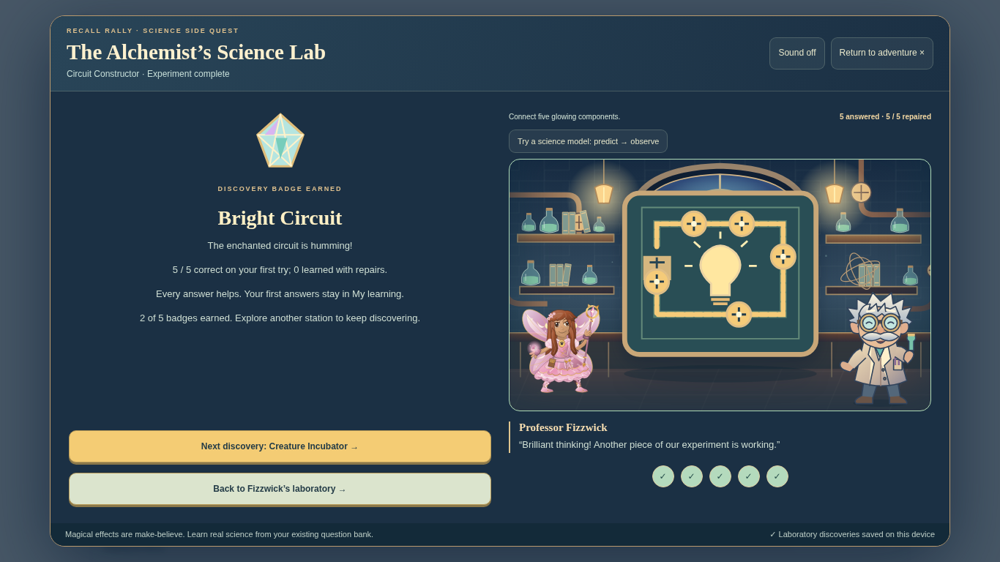

Potion Mixer benchmark on unchanged main:

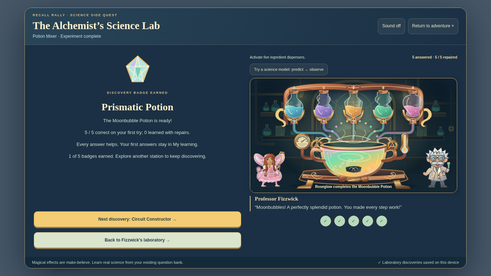

## Integrated gameplay

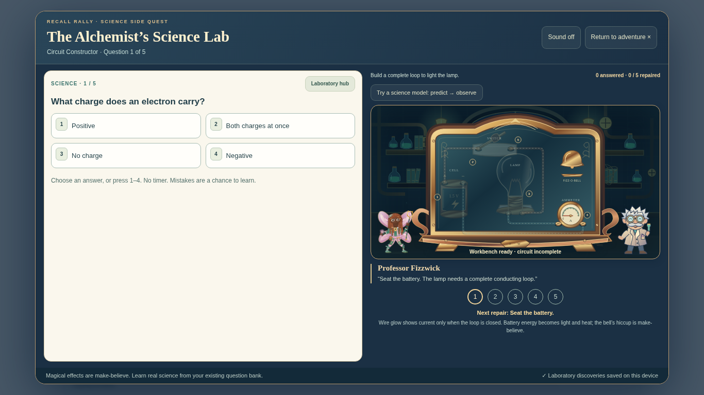

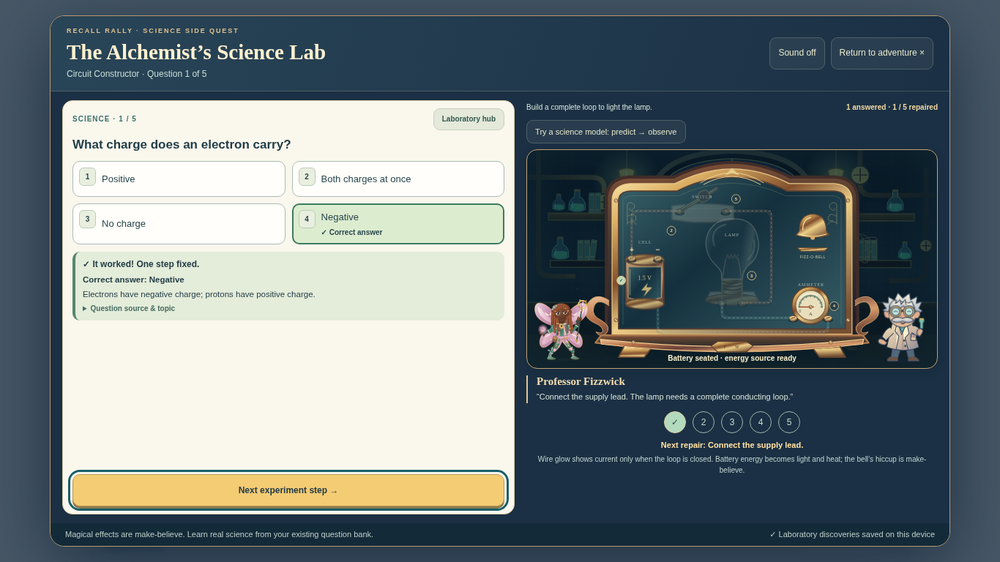

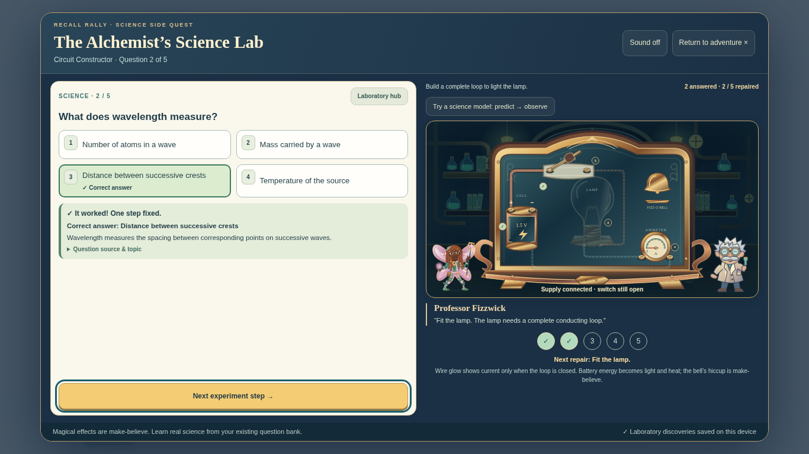

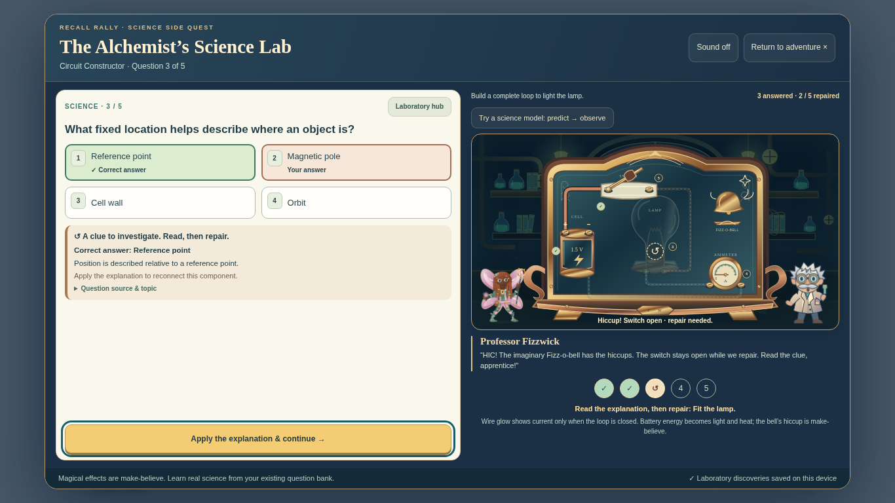

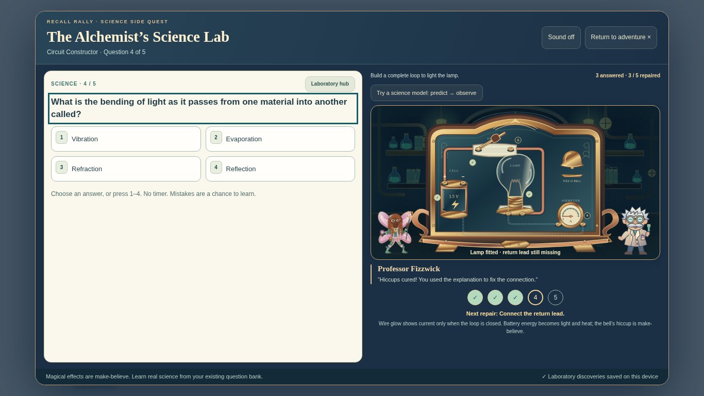

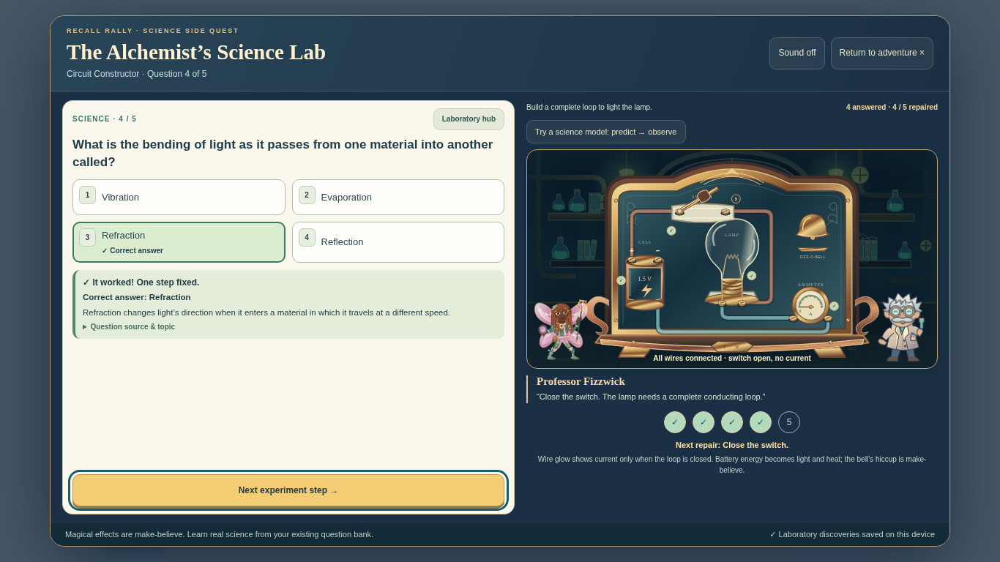

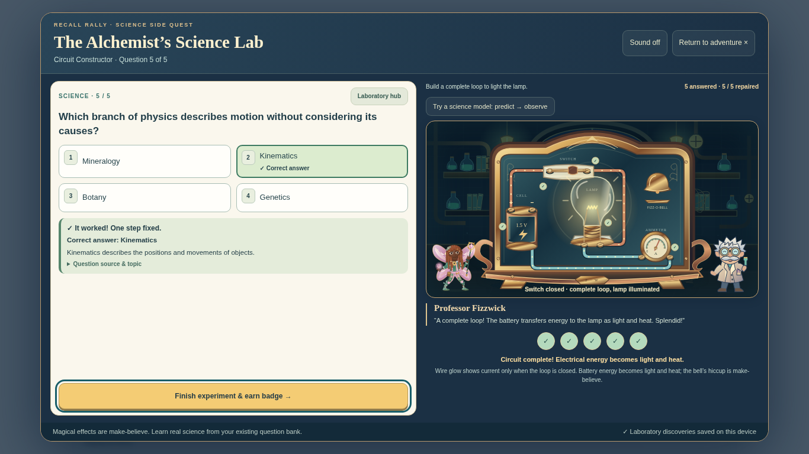

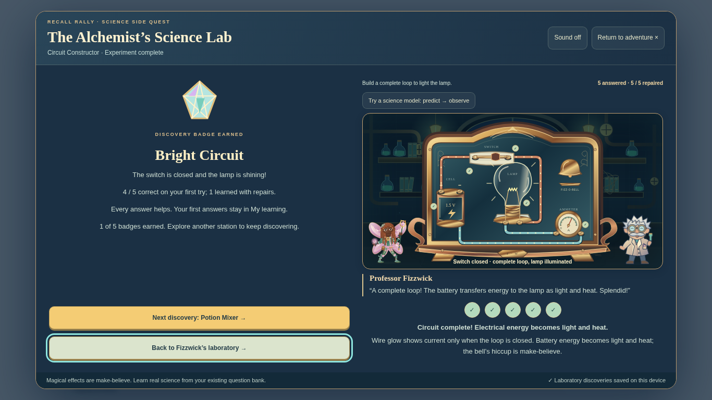

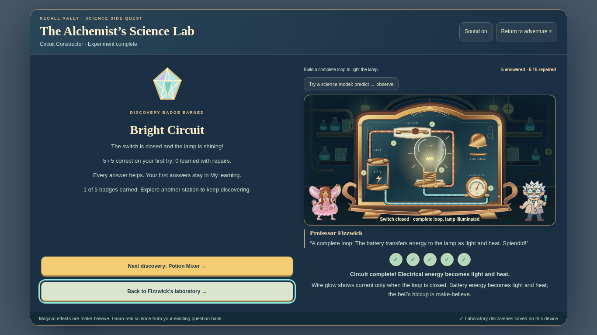

## Responsive gameplay

At 1366×768 and 1024×768, the machine, question, all choices, explanation, objective and Next fit within the viewport. Portrait tablet and phone use vertical scrolling with a fixed dialog header/footer; selecting an answer brings feedback and the Apply/Next control into view. Touch targets remain at least 44px. Mobile screenshots show both machine and scrolled answer-review states.

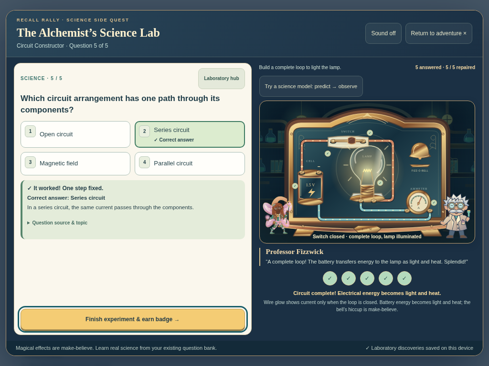

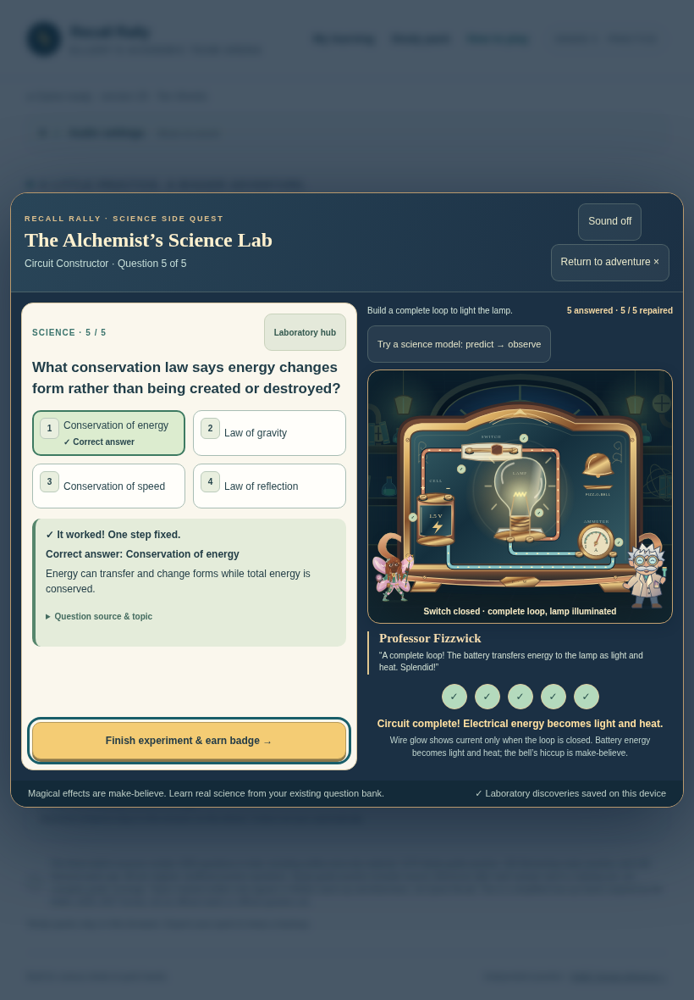

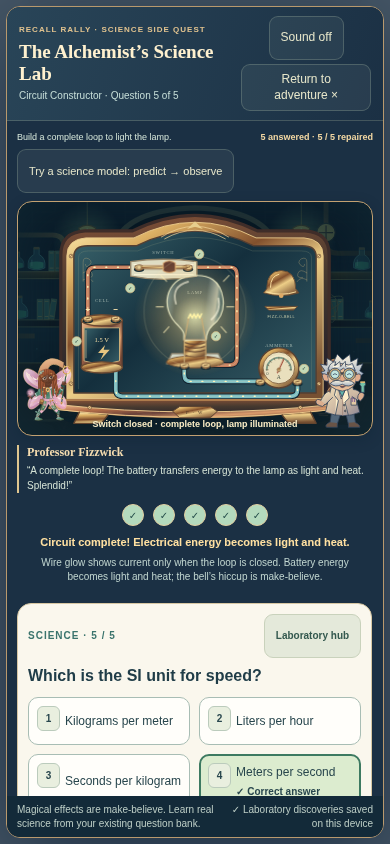

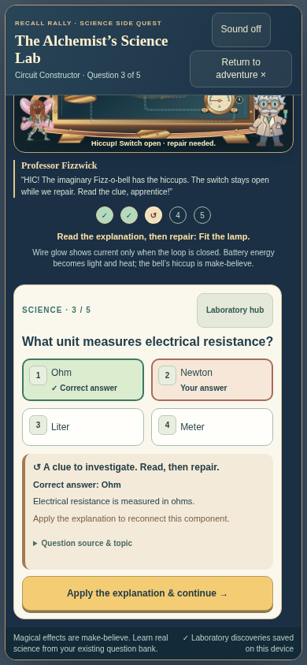

## Tests actually run

- `node scripts/build-standalone.cjs` — regenerated both shipped HTML integrations.
- `node tests/circuit-art.test.cjs` — six assembly states, five repair targets, no premature current/light or nonzero ammeter, internal SVG references, input sanitation, and exact embedded source in both builds.
- `CHROMIUM_PATH=/usr/bin/chromium CIRCUIT_SCREENSHOTS=docs/reviews/circuit-constructor node tests/circuit-browser.test.cjs` — Chromium at **1366×768, 1024×768, 820×1180 and 390×844**. Fifteen real Circuit answers per viewport (mixed, final mistake offline, all mistakes offline), plus a clean five-answer offline run: **65 graded answers**. Checks real bank content/options/explanations, duplicate-input guard, all five mistakes and repairs, original grades, final illumination, moving wire animation, keyboard and touch, layout bounds, reduced motion, optional open/closed-switch model, badge/history/profile persistence, unchanged hero/Rigby progress, reopening and all other station renderers. No page errors.
- `CHROMIUM_PATH=/usr/bin/chromium node tests/potion-browser.test.cjs` — benchmark's full four-viewport gameplay and offline regression passed.
- `CHROMIUM_PATH=/usr/bin/chromium node tests/science-lab-browser.test.cjs` — all five stations, exact bank records, first grades, all badges/Prism, browser restart, independent players, custom questions, offline play, backup import/export, storage failures, hero and existing Rigby seals passed.
- `CHROMIUM_PATH=/usr/bin/chromium node tests/science-lab-review.test.cjs` — all five optional models, notes/Prism, repairs, model layouts, source contrast and focus restoration passed.
- `CHROMIUM_PATH=/usr/bin/chromium node tests/adventure-save-browser.test.cjs` — existing seals, hero, interrupted encounters, independent profiles, imports, offline and damaged/quota-denied storage passed.
- `CHROMIUM_PATH=/usr/bin/chromium node tests/science-lab-static.test.cjs` — **every actual Amplify build command** succeeded in an isolated directory. Played the built Circuit to its closed-loop illuminated completion, tested its model and badge, played Potion Mixer, checked ten academic attempts, Librarian launcher and unchanged Rigby progress. Nothing deployed.
- All current Amplify unit gates passed: circuit art, potion art, science lab, answer recognition, home launcher, adventure saves/effects, question bank, ten worlds and Librarian v4. Original offline assets passed dimensions, size budget and no-remote-code/resource checks. `git diff --check` passed.

A dedicated `circuit-art.yml` PR workflow repeats artwork and four-viewport browser tests and uploads gameplay screenshots. The new pure-art check is also in the Amplify build.

Three historical Librarian tests (`librarian.test.cjs`, `librarian-dodge-v2.test.cjs`, `librarian-duck-v3.test.cjs`) still expect removed older buzz/defeated-pose APIs and fail. Each was reproduced unchanged in an isolated checkout of baseline `00656fd`; no Librarian source or legacy test was modified. The current Librarian v4 gate passes.

## Limits and follow-up

Browser/device coverage is automated Chromium with desktop and emulated touch viewports, not physical iPad/iPhone, Safari or Firefox. Direct `file://` navigation was blocked by the managed browser's administrator policy, so it is not claimed as tested. The self-contained document was loaded locally, then completed with network disabled; a separate all-correct run also passed after its server was stopped. No new asset loads are needed in play.

The next useful visual check is playing the switch closure and repair sequence on a physical iPad to confirm perceived timing and text size. Keep the PR in draft for review; do not merge to main.
