# Creature Incubator: playable graphics review

Branch: `feature/creature-incubator-illustrated-chamber`, based on `main` at `708b85e` (including the merged Circuit Constructor upgrade). No other feature branch was used as the base. No merge or production deployment is part of this work.

Open the game and choose **Science Lab → Creature Incubator**. Editable source is in `src/science-lab-creature.js`, `src/science-lab.css`, and the chamber SVG/generator. `index.html` and the self-contained `Ellery_Recall_Rally_Librarian_v4.html` contain the actual integrated artwork and animations.

## Visual benchmark and design

Inspected Potion Mixer's illustrated chassis, layered vessels, gauges, professor reactions, CSS motion, progress cues, incorrect-answer repair flow, browser tests and standalone build. The new incubator uses the same local layered illustration approach, with its own botanical identity: engraved copper arch, brass pedestal, transparent glass, ferns, moss, specimen dish, field notebook, ventilation fan, thermometer, moisture reservoir and adjustable light.

The Moonwing is an original fictional creature with mint fur, a crescent forehead marking, large expressive eyes, veined lavender wings, antennae and little paws. Its body, head, eyes, wings and waving paw are independently animated. Every movement is CSS scoped to this station; no new timers, frame loops, listeners, libraries, external fonts or remote assets are introduced.

| Repaired steps | Chamber changes | Moonwing behavior |
| --- | --- | --- |
| 0 | Five pending controls; dim chamber and inactive instruments | Sleeping in a crescent-patterned chrysalis |
| 1 | Ventilation fan turns; gentle airflow is visible | Sleeping peacefully |
| 2 | Thermometer rises to an illustrative steady warmth; warm light fills the habitat | Chrysalis begins wiggling before the reveal |
| 3 | Moisture indicator balances; existing fern fronds unfurl | Peeks out, breathes and blinks; folded wings |
| 4 | Light dial settles; soft light reaches the chamber | Stretches and moves its wings |
| 5 | All five controls show checks; habitat plaque reads READY; reveal halo and sparkles | Fully spread wings, gentle hover, blinking and a greeting wave |

Named **Air / Warmth / Moisture / Light / Check** indicators show completed and remaining work. The live scene caption describes the latest change; **Next repair** names the pending action. A wrong answer produces a bounded, harmless confetti sneeze with a fog puff, a squeezed-eye sneeze expression once the face is revealed, and a persistent repair ring around the unfinished control. Earlier successful repairs remain intact. Applying the existing explanation fixes exactly one step without changing the first-answer grade. Missing the final question cannot trigger the greeting/reveal until repaired.

## Science and preservation

Moonwings, their rapid reveal, sparkles and confetti sneezes are explicitly fantasy. Gauges are illustrations, not measurements or a proposed care protocol. The game explains that real organisms need suitable conditions and that their needs differ. Fern fronds unfold rather than claiming instant plant growth. The optional real photosynthesis model is unchanged and remains separate from growing the fictional creature.

Question IDs, selection, prompts, options, explanations, sources, grading, repair mechanics, journal and save format are unchanged. The customized hero still comes from `renderGameHero`. Potion Mixer, Circuit Constructor, Weather Machine, Observatory and the original professor artwork are preserved. Every new art layer is embedded in both shipped HTML documents for offline play.

## Actual gameplay screenshots

Original Creature Incubator on the baseline:

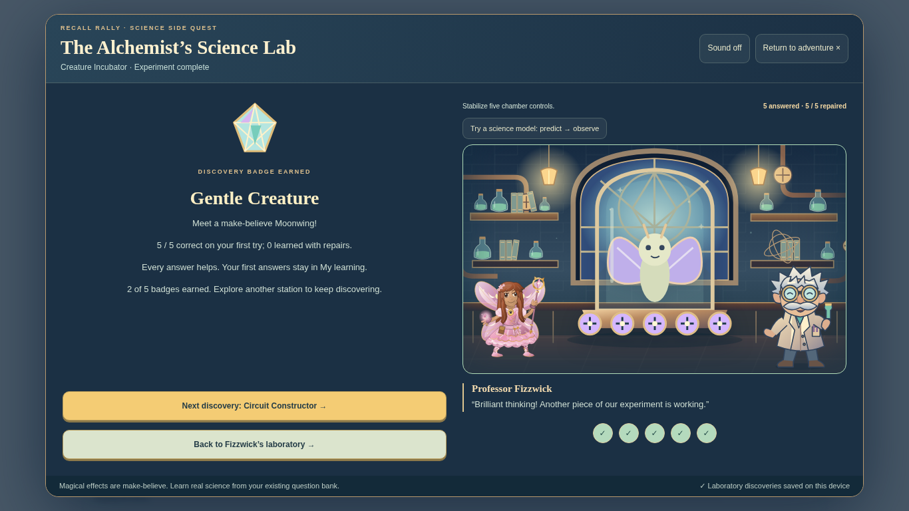

Completed Potion Mixer benchmark on the baseline:

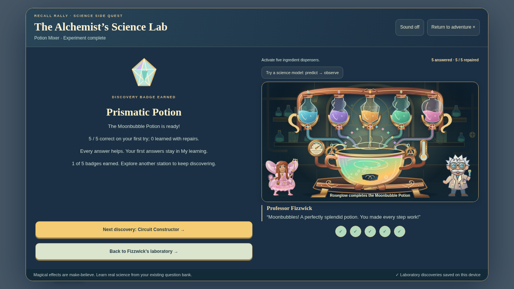

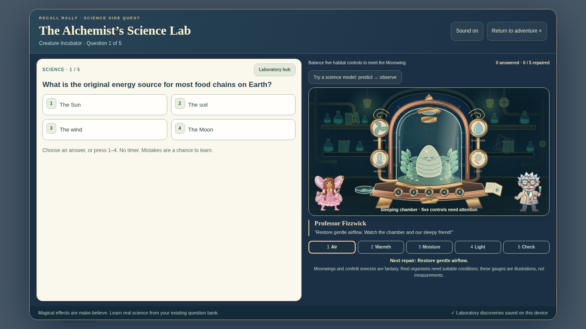

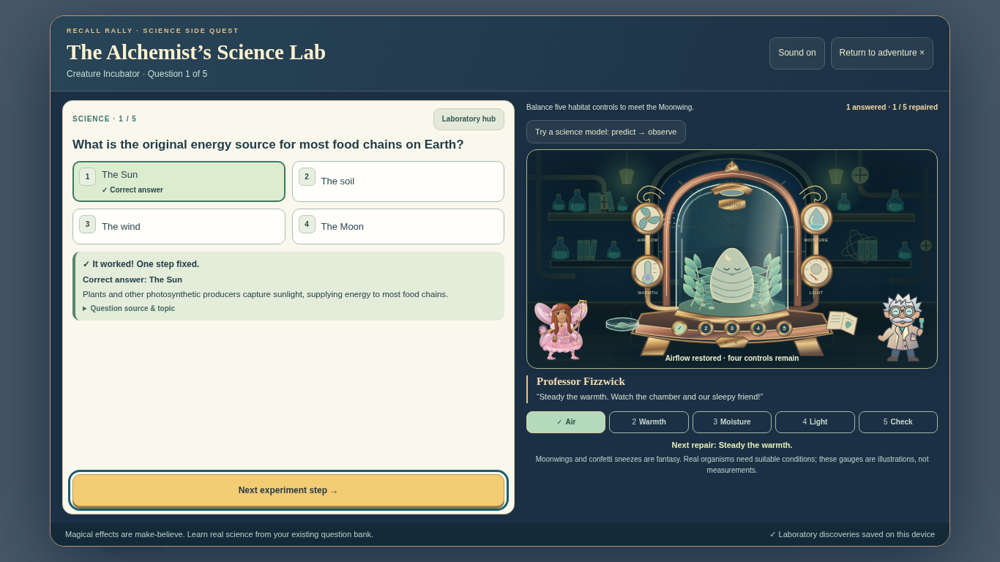

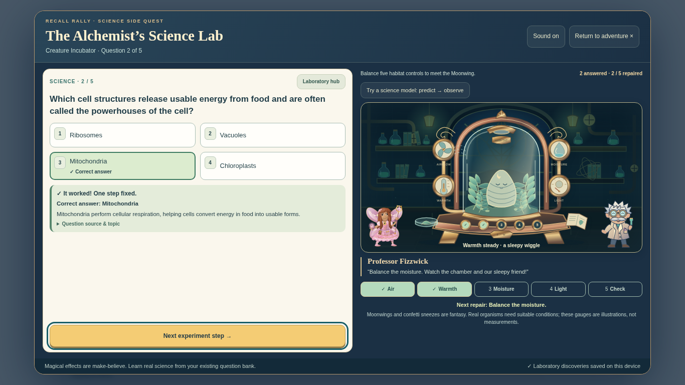

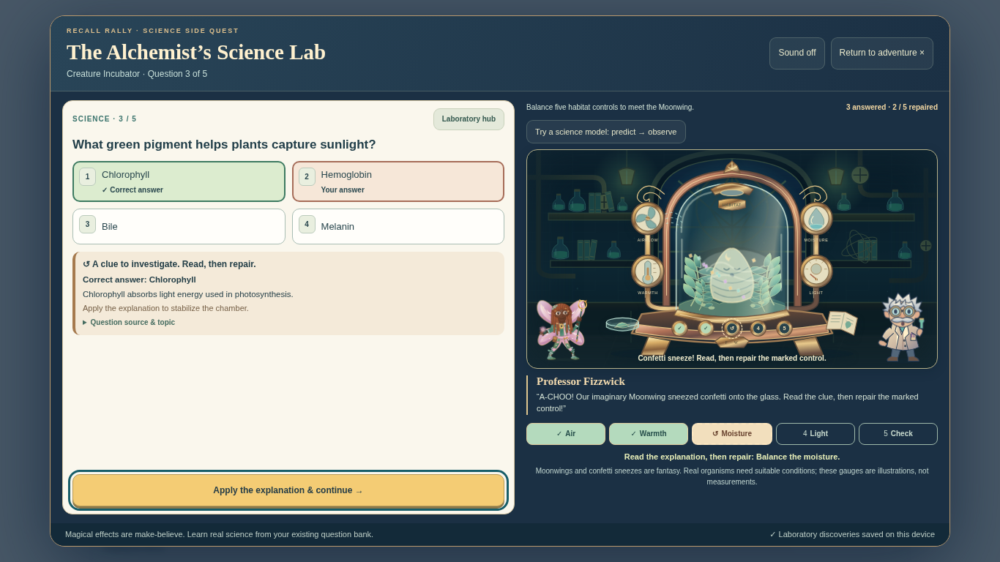

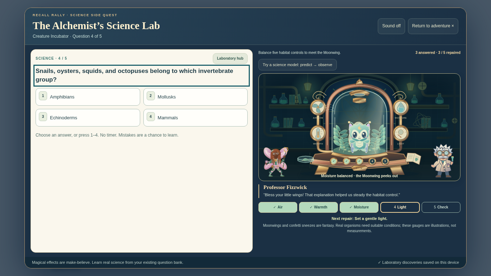

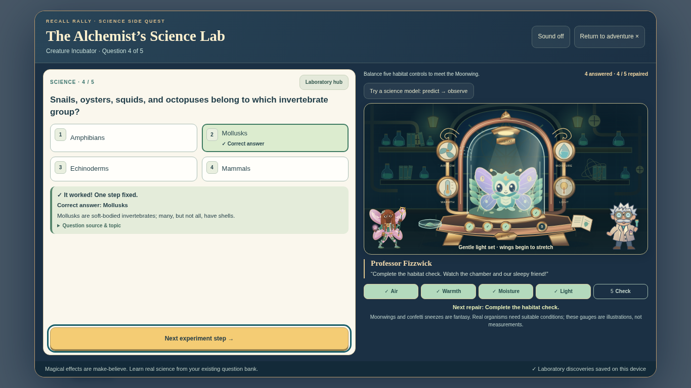

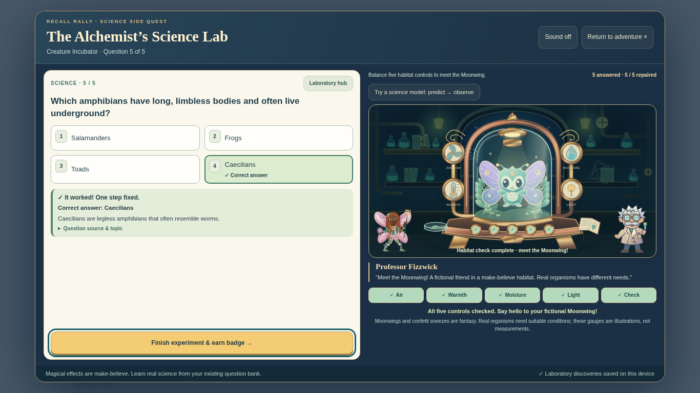

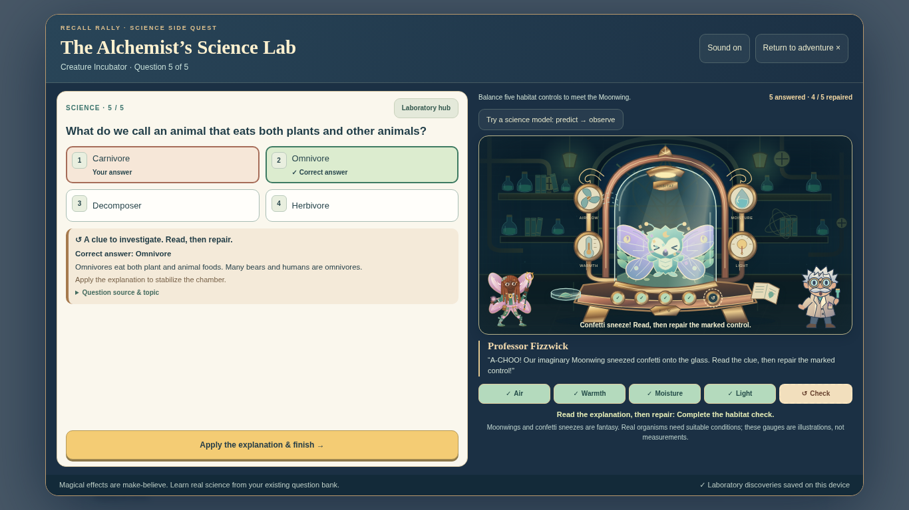

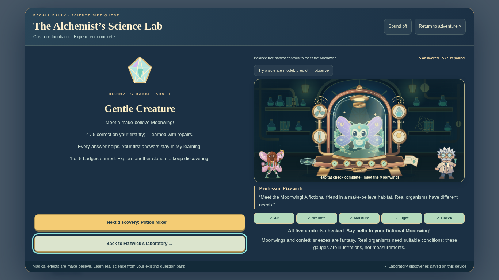

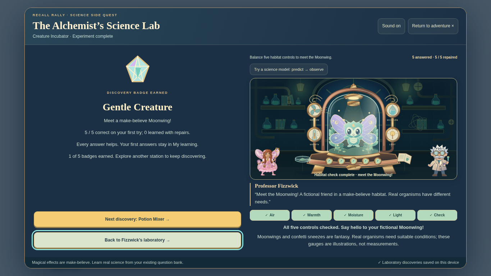

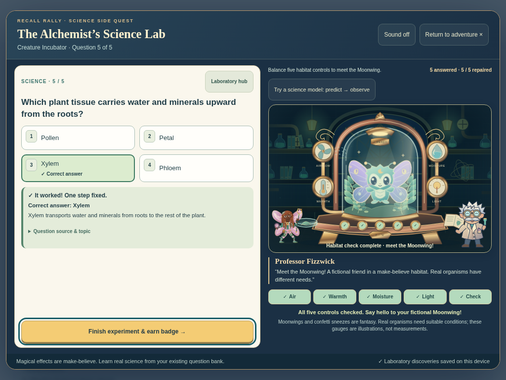

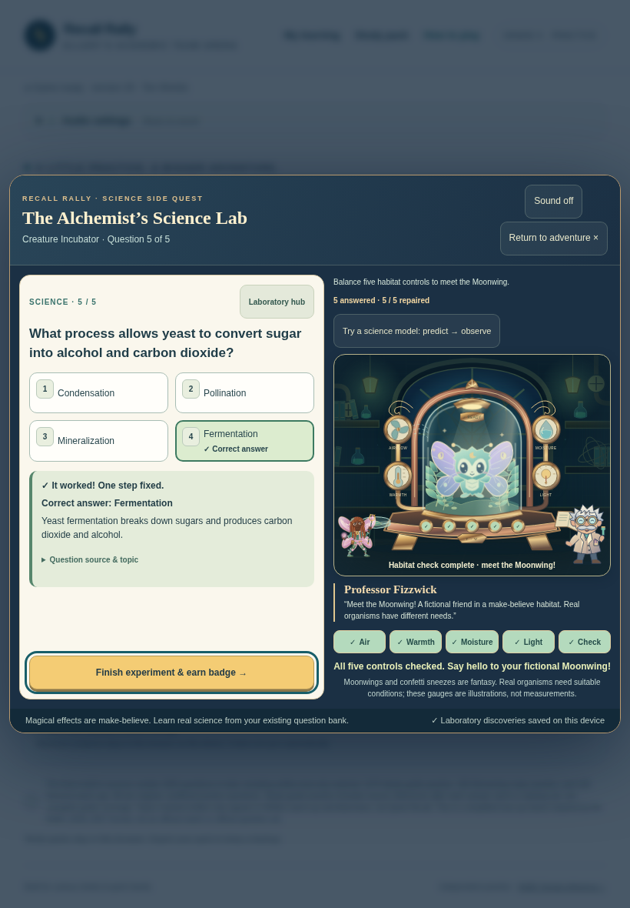

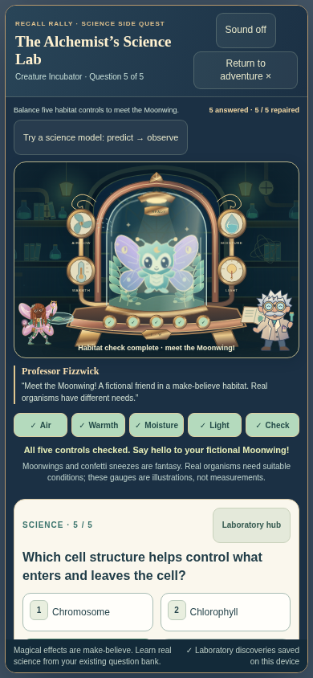

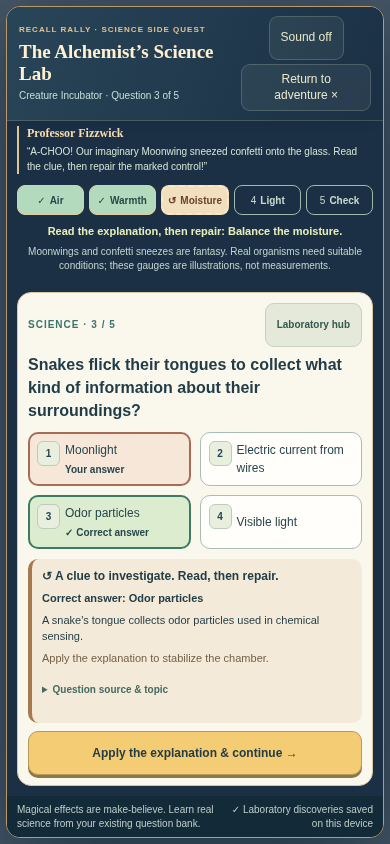

Desktop and landscape tablet keep the machine, question, all answers, feedback, named controls and Next within the viewport. Phone uses vertical scrolling; answering brings the explanation and Apply/Next into view. Control targets are at least 44px. Reduced motion removes animation while retaining visible controls, expressions, repair markers and the revealed creature.

## Tests actually run

- `node scripts/build-standalone.cjs` — regenerated both playable HTML documents from editable source/assets.
- `node tests/creature-art.test.cjs` — six distinct habitat states, five independent repair targets, one completed control per repair, pre-reveal creature states, no premature finale, 12 bounded confetti pieces, safe SVG identifiers/references, invalid-input clamping and exact source embedded in both HTML files.
- `CHROMIUM_PATH=/usr/bin/chromium CREATURE_SCREENSHOTS=docs/reviews/creature-incubator node tests/creature-browser.test.cjs` — **65 real graded answers** at **1366×768, 1024×768, 820×1180 and 390×844**. Mixed run, final-step error/repair offline, and every step missed/repaired offline at each size, plus a clean standalone 5/5 run. Verified original bank content/options/explanations, duplicate input guard, honest grades, exactly one academic attempt per question, no extra attempt for repairs, no premature reveal, real fan/cocoon/wing transforms, breathing animation, actual blink and greeting wave, sneeze expressions, keyboard/touch, layout bounds, reduced motion, optional photosynthesis model, saved badge/history, unchanged hero/Rigby progress, replay and other station isolation. No browser script errors.
- `CHROMIUM_PATH=/usr/bin/chromium node tests/potion-browser.test.cjs` and `node tests/circuit-browser.test.cjs` — both completed upgrades passed their full four-viewport gameplay and offline regressions.
- `CHROMIUM_PATH=/usr/bin/chromium node tests/science-lab-browser.test.cjs` — all five stations, shared bank/explanations/sources, first grades, all badges and Prism, browser restart, independent profiles, custom questions, offline play, lab backups, storage failures, preserved hero and existing Rigby seals passed.
- `CHROMIUM_PATH=/usr/bin/chromium node tests/science-lab-review.test.cjs` — all five real science models, field notes, repair behavior, Prism/reload, source contrast, four viewport layouts and focus restoration passed.
- `CHROMIUM_PATH=/usr/bin/chromium node tests/adventure-save-browser.test.cjs` — existing seals, interrupted duel, hero, profiles, reset confirmation, import/export, offline, damaged saves and denied/quota-limited storage passed.
- `CHROMIUM_PATH=/usr/bin/chromium node tests/science-lab-static.test.cjs` — ran **every actual Amplify build command** in isolated staging, then played Circuit and its model, Potion, and Creature including a missed answer and repair in the resulting static output. Verified three machine finales, 15 journal attempts, honest 4/5 Creature result, Librarian launcher and preserved Rigby progress.
- All current Amplify unit gates passed: Creature/Circuit/Potion art, science lab, answer recognition, home launcher, adventure saves/effects, question bank, ten worlds and Librarian v4.
- `node scripts/check-science-lab-assets.cjs` passed dimensions, byte budgets, complete SVG and no scripts/remote asset references. All six generated Creature SVG states also parsed as XML. Syntax and `git diff --check` passed.
- Separate final standalone check completed a clean five-answer run after stopping its local server and disabling browser networking: 5/5, five journal attempts, full reveal.

The new `creature-art.yml` PR workflow repeats art/browser checks and uploads gameplay images. Amplify runs the Creature art check. Screenshot generation can produce more images than the curated gallery committed here.

## Limits and next review

Testing used Chromium with desktop and emulated touch devices, not physical iPad/iPhone, Safari or Firefox. Offline tests load the self-contained HTML locally before disconnecting; direct file launch is not claimed as verified. No hosted preview URL or deployment is claimed.

The next useful visual check is the Moonwing's wing stretch, blink and sneeze timing on a physical iPad. Keep this as a draft PR for review; do not merge into `main`.
