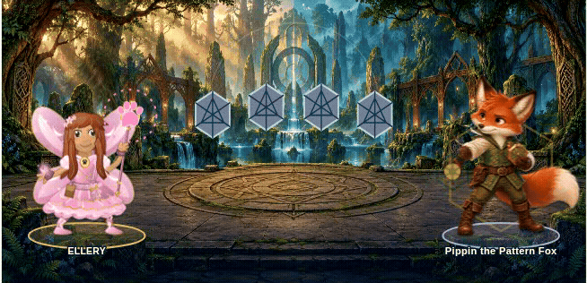
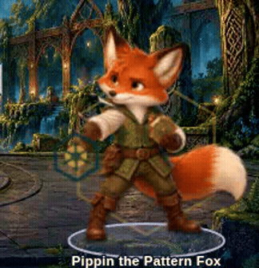

# Guardian animation and motion polish

Branch: `feature/guardian-jointed-motion`, based on `2642929` (main after approved [PR #18](https://github.com/MaxxSomers1220/RecallRally/pull/18)). No gameplay or artwork changes from an unmerged branch are required.

## Watch the actual game

The recordings use the playable standalone game, real UI choices, and its normal animation clock. They include incorrect-answer magic, correct-answer explanations, Next, and earned victory. They are not rendered previews or interpolated still screenshots. Sound was disabled with the game's existing preference. Videos are encoded at their recorded speed; GIFs are crops of recorded frames.

- [Pippin: idle, casting, return, reactions and victory](pippin-sequence.mp4)
- [Phone: the same encounter using touch input and the stacked layout](phone-sequence.mp4)
- [All ten guardians in real encounters](desktop-journey.mp4)
- [Before: the approved PR #18 game](before.mp4)





## What changed

One native-resolution painted cast frame becomes an articulated SVG puppet for each guardian. Registered cut paths separate the head, ears/antennae, shoulders, elbows, wrists/hands and held equipment, tails, wings and wing tips, and cloth where that anatomy is present. The owl's wing acts as its forelimb. Support feet remain on their original baseline. Joint caps and local source-texture repairs cover the previously occluded areas exposed by movement.

The presentation controller interpolates the complete listening → anticipation → cast → follow-through → reaction → listening path. Reactions and celebration have distinct targets; wrong-answer casts align with the existing spell release. The charge glow follows the animated palm or instrument. Existing projectile duration, impact timing, grading and attack results remain intact.

Quiet rhythms differ across all ten characters: Pippin's ears and tail, Fern's breathing and attentive feather gesture, Compass's head and coat, Quill's tail and wing tips, Maestro's antennae and layered wings, Flint's slower gaze, Tock's deliberate head motion and apron, Lyra's ears/tail/scarf, Zephyr's folding feathers, and Astra's slow wing and tail settling. Head/ear gestures have pauses. Eye apertures blink over the original painted texture. No full-figure dissolves or doubled sprites are used.

A single animation loop carries joint positions across the game's DOM replacements. It detaches on exit, freezes with pause/visibility, and respects live reduced-motion changes. Reduced motion shows static listening, casting, reaction, celebration and defeat feedback without an idle animation loop.

## Asset provenance and preservation

All 30 original guardian pose WebPs and both original fabric swatches from PR #18 are **byte-for-byte unchanged**, with SHA-256 validation against `assets/characters/manifest.json`. The approved paintings were originally generated with OpenAI image generation; their existing source identifiers and hashes remain in that manifest. This PR adds hand-authored native-pixel cut paths, pivots and motion curves, and reuses painted pixels for underlapping joints and lids. It generates no replacement character paintings and downloads no third-party artwork.

The original hero renderer, appearance IDs/presets, saved hero data, question bank, save module and Librarian controller remain intact. All three new motion source modules are embedded in both `index.html` (Amplify input) and `Ellery_Recall_Rally_Librarian_v4.html`. No runtime network request, CDN, animation library, or new runtime dependency is added.

## Verification

See [test results](test-results.md) and the attached plain-text test logs. All device names below refer to **automated Chromium viewport/touch emulation**, not physical laptops, tablets, or phones. Physical iPad/iPhone, Safari and Android device testing were not performed.

Reproduce from the repository root with Node, Playwright and Chromium available:

```sh
node scripts/build-standalone.cjs
node tests/guardian-motion.test.cjs
node tests/guardian-motion-browser.test.cjs
node tests/adventure-static.test.cjs
node tests/character-browser.test.cjs
node tests/adventure-save-browser.test.cjs
node tests/science-lab-static.test.cjs
```

Set `CHROMIUM_PATH` to the installed Chromium executable. Set `GUARDIAN_RECORDINGS` to capture the full four-layout test videos. `node scripts/record-guardian-motion.cjs` records the first encounter; `MOTION_PHONE=1` uses the phone layout and touch. `MOTION_REFERENCE_HTML` can point to the immutable baseline HTML from `git show 2642929:Ellery_Recall_Rally_Librarian_v4.html`.
