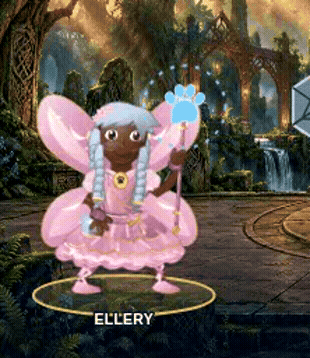

# Advanced customizable hero

Branch: `feature/advanced-custom-hero`, from main `e8bb1e6` after approved PRs [#18](https://github.com/MaxxSomers1220/RecallRally/pull/18) and [#19](https://github.com/MaxxSomers1220/RecallRally/pull/19).

## Watch the actual game

- [Before: the same customized Fairy in the approved main build](before-fairy.mp4)
- [After: Fairy creator, idle, missed-answer attack, casts, explanations and victory](after-fairy.mp4)
- [After: customized Panther through the same playable sequence](after-panther.mp4)
- [Phone: real touch choices and the responsive encounter](after-fairy-phone.mp4)
- [Librarian: real-time running, ducking, jumping, dash, shield, hits and recovery](librarian-real-controls.mp4)

The encounter videos use real UI choices and the normal game clock. The Librarian recording uses native keyboard controls and reads the question helper only to identify choices; it does **not** freeze the clock, spawn hazards, inject progress or change collisions. Its storm outcome is genuine, including defeat when the player takes four hits. The Librarian clip includes setup and the complete storm. GIFs crop and sample recorded frames at real speed; they do not synthesize intermediate frames or retime motion.




## Illustration and movement

The same composable hero renderer serves both Fairy and Panther styles throughout the creator, map, duels, Science Lab, Librarian and Rigby reunion. It retains the existing six face silhouettes, hair choices, selectable colors, hoods/ears/masks, garments, shoes, wings, equipment, emblems, accessories and expressions. There is no fixed replacement hero or reduced preset system.

New portrait shading models the forehead, cheeks, nose and chin over the selected skin color. Painted iris fibers, catchlights and eyelids add expression. Four small original grayscale relief materials shade skin, satin, leather and metal inside the existing selectable shapes. Fine bindings and metalwork stay with the selected implement. Existing outfit-specific construction, embroidery, material fibers and silhouettes remain composable.

Registered shoulder/elbow/wrist chains keep hands and implements together. Hip/knee/ankle chains bend without stretching anatomy; inverse kinematics anchors standing/crouching feet. Front and back torso transforms stay registered so the cape, wings and back hair follow a crouch or weight shift. Hair, ears, cloth, wing opening/folding and cape settling have secondary motion. Quiet movement leaves pauses for studying.

The complete listening → anticipation → casting → follow-through → reaction → listening path responds to real encounter state. Ward, blocked hits and unblocked hits use their actual tactical outcome. Starfall and replay restart the presentation without changing their rules or timing. The charge glow and creator preview glyph follow the animated implement. Librarian movement uses the existing physics and controls, with joint settling at starts, stops and landings. Map travel and reunion also use the shared hero.

A single hero presentation loop tracks visible heroes and the active duel. It carries pose values across render/Next, suspends on pause/hidden pages, discards old encounter ownership, bounds its cache and avoids animating preset thumbnails. Reduced motion uses clear static action poses and stops the idle loop.

## Preservation and provenance

[Material manifest](../../../assets/hero-advanced/manifest.json) · [Art provenance](../../../assets/hero-advanced/PROVENANCE.md)

The four new material WebPs total **53,876 bytes**. They are original OpenAI image_gen relief paintings, cropped/resampled/packed by the included preparation script. Character faces, components, equipment construction, cut paths and motion are authored SVG/JavaScript. No third-party art, runtime animation dependency or external asset request was added.

All original guardian paintings, fabric swatches, guardian motion modules, appearance IDs/defaults/presets, question data, save module and 22 gameplay/hero entrypoint contracts remain protected. Librarian gameplay source remains byte-identical after removing **two exact, independently checked presentation blocks**: one bypasses the obsolete graphic splitter for the already-articulated hero, and one publishes dash/shield state as DOM presentation flags. The blocks do not alter physics, controls, grades or timers.

The 48 existing illustration snapshot hashes were intentionally refreshed for this requested drawing/rig upgrade. Their saved appearance inputs are unchanged, independently protected by SHA-256 `841d1025d20aa3f00d9dba01c6f44844f7c0982581a82cf6b3b8ee955651dd6f`. No academic or collision contract was rebaselined.

All artwork and both new hero modules are embedded in `index.html` and the complete standalone HTML. Actual Amplify output is built and played in isolated staging; no separate runtime asset copying or CDN is required.

## Verification and limits

See [test results](test-results.md), [rendering measurements](render-performance.json), and the included plain-text logs. All device labels mean **automated Chromium viewport/touch emulation**. Physical laptops/tablets/phones, Safari/Firefox and device battery/performance were not tested. Direct `file://` opening is not verified in this managed browser; offline play was verified with the loaded standalone game and all network requests blocked. No deployment is claimed.

The creator preview has more painted detail and animated joints, and costs more CPU than the baseline in the headless measurements. This is a documented tradeoff, not a claim of 60 fps on every device. Shared source geometry and small texture budgets limit duplication; a physical-device check is the next useful visual/performance review.

## Reproduce

Use Node, Playwright and Chromium (`CHROMIUM_PATH` selects the executable):

```sh
node scripts/build-standalone.cjs
node tests/hero-advanced.test.cjs
node tests/character-art.test.cjs
node tests/hero-motion-browser.test.cjs
node tests/character-browser.test.cjs
node tests/librarian-illustrated-browser.test.cjs
node tests/adventure-static.test.cjs
node tests/adventure-save-browser.test.cjs
node tests/science-lab-static.test.cjs
```

`HERO_VIEWPORT=desktop,tablet-landscape` or `tablet-portrait,phone` runs a subset of the motion matrix. `HERO_SCREENSHOTS` captures its review states. `scripts/record-hero-advanced.cjs` records the encounter, with `HERO_STYLE=panther` or `HERO_PHONE=1` selecting variants. `scripts/record-hero-librarian.cjs` records the live arcade. `scripts/measure-hero-render.cjs` writes the comparative rendering observations; set `HERO_REFERENCE_HTML` to an immutable baseline HTML for before/after capture.

## Both styles and all six outfits

These are live creator captures, with a range of saved appearance choices.

| Outfit | Fairy | Panther |
| --- | --- | --- |
| Mage | [Creator](motion/desktop-fairy-mage-creator.jpg) · [Cast](motion/desktop-fairy-mage-cast.jpg) | [Creator](motion/desktop-panther-mage-creator.jpg) · [Cast](motion/desktop-panther-mage-cast.jpg) |
| Ranger | [Creator](motion/desktop-fairy-ranger-creator.jpg) · [Cast](motion/desktop-fairy-ranger-cast.jpg) | [Creator](motion/desktop-panther-ranger-creator.jpg) · [Cast](motion/desktop-panther-ranger-cast.jpg) |
| Knight | [Creator](motion/desktop-fairy-knight-creator.jpg) · [Cast](motion/desktop-fairy-knight-cast.jpg) | [Creator](motion/desktop-panther-knight-creator.jpg) · [Cast](motion/desktop-panther-knight-cast.jpg) |
| Scholar | [Creator](motion/desktop-fairy-scholar-creator.jpg) · [Cast](motion/desktop-fairy-scholar-cast.jpg) | [Creator](motion/desktop-panther-scholar-creator.jpg) · [Cast](motion/desktop-panther-scholar-cast.jpg) |
| Bard | [Creator](motion/desktop-fairy-bard-creator.jpg) · [Cast](motion/desktop-fairy-bard-cast.jpg) | [Creator](motion/desktop-panther-bard-creator.jpg) · [Cast](motion/desktop-panther-bard-cast.jpg) |
| Alchemist | [Creator](motion/desktop-fairy-alchemist-creator.jpg) · [Cast](motion/desktop-fairy-alchemist-cast.jpg) | [Creator](motion/desktop-panther-alchemist-creator.jpg) · [Cast](motion/desktop-panther-alchemist-cast.jpg) |

[Customized Rigby reunion](rigby-reunion.jpg) · [Librarian crouch beneath a real high book](arcade/desktop-dodge.png) · [Phone encounter](motion/phone-panther-knight-cast.jpg). The Librarian snapshots use the controlled-step regression test; the video uses real time.
