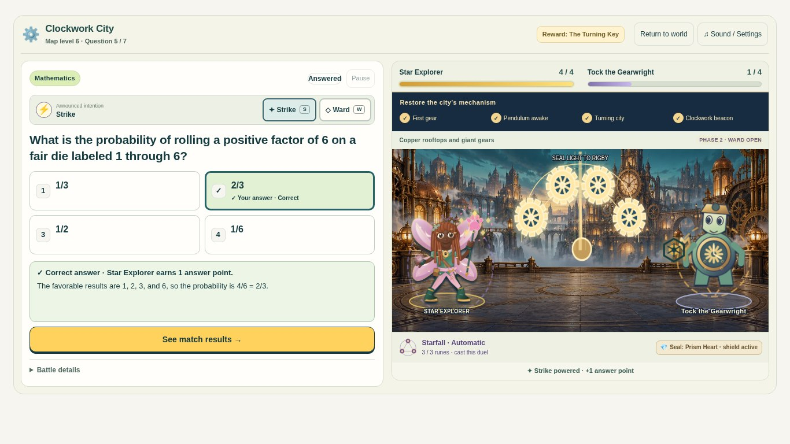
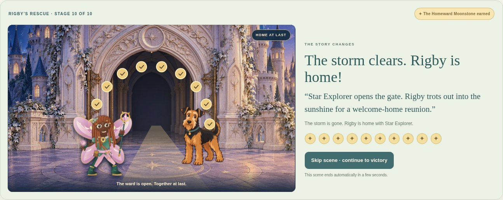

# Rescue Rigby and the ten illustrated worlds

Implemented in the playable adventure on `feature/rigby-ten-worlds-illustrated`, based on `main` at `1e543ea` (which includes the completed Librarian upgrade). This is a review branch, not a production deployment.

## Play the result

Run `node scripts/build-standalone.cjs`, then open the complete `Ellery_Recall_Rally_Librarian_v4.html` through a local static server. Choose **Rescue Rigby / Start a New Adventure**, finish the character creator, and continue to the first guardian. Existing saves also work. The raw source `index.html` is assembled by the normal Amplify build; its separate Librarian files must be copied/injected by that build when reviewing all game modes.

The adventure still uses multiple-choice academic duels: four answer points win a guardian’s seal, three successful answers automatically cast Starfall, and ten distinct seals free Rigby. The Science Lab’s five experiment steps have not been substituted for these existing rules.

## What changed

- Thirteen original paintings: ten individual arena environments, two map chapters, and Rigby’s castle courtyard.
- Ten individual illustrated guardians replace the emoji combat portraits. Heads, arms, wings and tails respond to the encounter; eyes blink and expressions change with the existing result state.
- Four named, live restoration steps per world. The second success changes the arrangement or opens a mechanism; the third powers existing Starfall; the fourth activates the rescue beacon. Mistakes retain the earned state and the original explanation.
- Observable mechanisms include observatory shutters, a gear train and swinging pendulum, protected floating pages, a flowering bridge, and lunar seals. These sit above the painted background, behind the combatants and spells.
- Rigby keeps the familiar Airedale illustration, with independent head and tail movement. Each earned seal changes the doorway, storm, light and ward. Only the tenth victory removes the ward and brings the actual saved hero into the reunion.
- Live map trail, markers, names, keys, controls, scores and learning text remain interface elements. The map’s original path coordinates and travel behavior are preserved.
- Compact duel styles now hide home-screen content that was consuming laptop space. Phone restoration labels use two columns; questions remain the first element in the reading order.
- All new art is embedded in both the published static game and the single-file offline build. No runtime network dependency was added.

The immutable gameplay contract test checks 22 original functions against `main`, including deck selection, grades, scoring, Ward/Strike, timers, Starfall, reward advancement, cleanup and shared hero rendering. The save module is byte-identical. Existing question banks, explanations, history and all five laboratory stations remain intact.

## Actual gameplay gallery

These are browser screenshots of the functioning game. `before-*` captures use the unchanged `main` game with its default hero; final captures use creator-selected customized heroes. Questions vary because the existing deck selection still rotates them. No interface was painted over or composited into the screenshots.

`staged-*` captures come from the **actual Amplify command output**, served locally. Phone and tablet captures come from the **complete standalone HTML**. The main desktop staged run uses normal motion; tablet/phone runs use reduced motion. Screenshot times can show different moments of an existing spell or arrival animation.

### Before and after

| View | Before | After |
| --- | --- | --- |
| Mosswood laptop | [Original arena](before-desktop-world-0.png) | [Painted arena and customized hero](staged-desktop-world-0-question.jpg) |
| Crystal Caverns laptop | [Original arena](before-desktop-world-5.png) | [Painted arena](staged-desktop-world-5-question.jpg) |
| Moonstone laptop | [Original arena](before-desktop-world-9.png) | [Painted arena](staged-desktop-world-9-question.jpg) |
| Phone | [Original layout](before-phone-world-0.png) | [Current live question and controls](phone-world-0-question.jpg) |
| Map | [Original laptop map](before-desktop-map.png) / [phone](before-phone-map.png) | [Sunlit Lands](staged-desktop-map-sunlit.jpg) / [Beyond the Mist](staged-desktop-map-beyond-mist.jpg) |



### Every world, before its first answer and after four correct answers

| World / guardian | Initial encounter | Restored world |
| --- | --- | --- |
| Mosswood Meadows / Pippin | [Question](staged-desktop-world-0-question.jpg) | [Geometric sanctuary](staged-desktop-world-0-restored.jpg) |
| Firefly Forest / Professor Fern | [Question](staged-desktop-world-1-question.jpg) | [Aligned observatory](staged-desktop-world-1-restored.jpg) |
| Compass Coast / Captain Compass | [Question](staged-desktop-world-2-question.jpg) | [Lit sea route](staged-desktop-world-2-restored.jpg) |
| Storybook Peaks / Quill | [Question](staged-desktop-world-3-question.jpg) | [Awakened library](staged-desktop-world-3-restored.jpg) |
| Cloudsong Castle / Maestro Moth | [Question](staged-desktop-world-4-question.jpg) | [Colored performance hall](staged-desktop-world-4-restored.jpg) |
| Crystal Caverns / Flint | [Question](staged-desktop-world-5-question.jpg) | [Illuminated crystals](staged-desktop-world-5-restored.jpg) |
| Clockwork City / Tock | [Question](staged-desktop-world-6-question.jpg) | [Turning mechanisms](staged-desktop-world-6-restored.jpg) |
| Sunken Library / Lyra | [Question](staged-desktop-world-7-question.jpg) | [Protected archive](staged-desktop-world-7-restored.jpg) |
| Skygarden Isles / Zephyr | [Question](staged-desktop-world-8-question.jpg) | [Living bridge](staged-desktop-world-8-restored.jpg) |
| Moonstone Citadel / Astra | [Question](staged-desktop-world-9-question.jpg) | [Final lunar beacon](staged-desktop-world-9-restored.jpg) |

### Full sequence and rescue

[Ward cast](staged-desktop-ward-cast.jpg) · [Incorrect answer, spell and explanation](staged-desktop-mistake-and-explanation.jpg) · [Second milestone](staged-desktop-second-milestone.jpg) · [Mosswood Starfall](staged-desktop-world-0-starfall.jpg) · [Prism Starfall](staged-desktop-world-5-starfall.jpg) · [Lunar Starfall](staged-desktop-world-9-starfall.jpg) · [Defeat](staged-desktop-defeat.jpg) · [Offline rematch](staged-desktop-offline-reduced-victory.jpg).

Actual rescue cutaways after earned seals: [1](staged-desktop-rescue-1.jpg), [2](staged-desktop-rescue-2.jpg), [3](staged-desktop-rescue-3.jpg), [4](staged-desktop-rescue-4.jpg), [5](staged-desktop-rescue-5.jpg), [6](staged-desktop-rescue-6.jpg), [7](staged-desktop-rescue-7.jpg), [8](staged-desktop-rescue-8.jpg), [9](staged-desktop-rescue-9.jpg), [10 and reunion](staged-desktop-rescue-10.jpg). [Completed map](staged-desktop-completed-map.jpg).



### Phone and tablet evidence

Phone: [first question and touch controls](phone-world-0-question.jpg), [miss/explanation](phone-mistake-and-explanation.jpg), [second milestone](phone-second-milestone.jpg), [final question](phone-world-9-question.jpg), [restored final world](phone-world-9-restored.jpg), [reunion](phone-rescue-10.jpg), [defeat](phone-defeat.jpg), [offline reduced-motion rematch](phone-offline-reduced-victory.jpg), [Sunlit map](phone-map-sunlit.jpg), [Mist map](phone-map-beyond-mist.jpg), [completed map](phone-completed-map.jpg).

Tablet landscape: [first question](tablet-landscape-world-0-question.jpg), [final question](tablet-landscape-world-9-question.jpg), [reunion](tablet-landscape-rescue-10.jpg). Tablet portrait: [first question](tablet-portrait-world-0-question.jpg), [final question](tablet-portrait-world-9-question.jpg), [reunion](tablet-portrait-rescue-10.jpg).

## Tests actually run

Automated **Chromium**, October 30, 2026. These are viewport/touch emulation tests, not physical-device tests.

| Check | Result |
| --- | --- |
| 1366×768 laptop | Complete ten-world journey; normal-motion spells, Ward, phase change, Starfall, four earned scenery steps and ten rescue stages; final run played the actual Amplify output |
| 1024×768 landscape tablet | Complete ten-world journey with reduced motion and touch capability; choices, question, arena and Next fit |
| 820×1180 portrait tablet | Complete ten-world journey; responsive reflow, no horizontal overflow |
| 390×844 phone | Complete ten-world journey using native touch taps for choices; real Panther-style hero customized through creator controls; readable stacked layout, no horizontal overflow |
| Grades/history | Every full journey used 50 real built-in questions: 40 correct and 10 incorrect; exact journal/run records, four-point victories and one seal per world |
| Defeat and recovery | Four real misses produce defeat without removing keys; leaving/reopening restarts temporary duel progress; all ten seals and the customized hero survive reload |
| Offline/reduced motion | Browser network disconnected after loading; full final-world rematch succeeds; new art renders, motion stops, state feedback remains; no extra seal or rescue replay |
| Build | Every command from `amplify.yml` executed in an isolated staging directory; all unit gates passed; complete journey played from `dist/index.html` |
| Art | 13 WebP paintings decoded; 10 guardian SVGs parsed; dimensions, byte budgets, no SVG scripts/remote references, provenance and SHA-256 checked |
| Preserved logic | 22 original functions and unchanged save module checked; existing 140 intent/spell/result cases, all ten worlds, bank coverage, duplicate scoring, Ward priority/expiry, Starfall and timers pass |
| Save regressions | Existing browser tests pass: separate players, interrupted duels, import/export, deployment update, denied/quota storage and corrupt-save recovery |
| Other game modes | Existing player-experience, full Librarian browser and Science Lab browser suites pass at their four viewport sizes; 48 default shared-hero outputs remain byte-identical |

Commands:

```sh
node scripts/build-standalone.cjs
python scripts/check-adventure-assets.py
node tests/adventure-illustrations.test.cjs
node tests/adventure-effects.test.cjs
node tests/worlds.test.cjs
CHROMIUM_PATH=/usr/bin/chromium node tests/adventure-illustrated-browser.test.cjs
CHROMIUM_PATH=/usr/bin/chromium node tests/adventure-static.test.cjs
CHROMIUM_PATH=/usr/bin/chromium node tests/adventure-save-browser.test.cjs
CHROMIUM_PATH=/usr/bin/chromium node tests/player-experience-browser.test.cjs
CHROMIUM_PATH=/usr/bin/chromium node tests/librarian-illustrated-browser.test.cjs
CHROMIUM_PATH=/usr/bin/chromium node tests/science-lab-browser.test.cjs
git diff --check
```

The full encounter test was also run independently with `RIGBY_VIEWPORT=desktop`, `tablet-landscape`, `tablet-portrait` and `phone`. `RIGBY_SCREENSHOTS` enables gameplay captures. New CI repeats the four-size standalone test, the actual Amplify test, save tests and asset checks.

## Provenance, packaging and limits

See [the asset manifest](../../../assets/adventure/manifest.json) and [provenance/illustration briefs](../../../assets/adventure/PROVENANCE.md). New raster art is approximately 3 MB before base64 embedding. The complete self-contained HTML is approximately 6.2 MiB. Both builds contain all new art and retain the existing self-contained/offline architecture.

No deployment or production merge was performed. Physical iPad/iPhone, Safari, Firefox, long-session battery use, and performance on older hardware remain untested. The offline check covers a locally served game after disconnecting its network; direct `file://` opening is not claimed as tested. A physical iPad/Safari playthrough is the highest-value next review.
