# Weather Machine: playable graphics review

Independent branch: `feature/weather-machine-illustrated-atmosphere`. Based on `main` at `35b2be4` (including the completed Potion Mixer, Circuit Constructor and Creature Incubator). This PR changes only the Weather Machine presentation and its tests/build integration. The other requested sky-station upgrade has its own branch and PR.

To review: open the branch game → **Science Lab → Weather Machine**. Both `index.html` and `Ellery_Recall_Rally_Librarian_v4.html` contain the actual playable upgrade. No production deployment or merge is part of this change.

## Artwork, motion and gameplay

Inspected Potion Mixer's completed chassis, layered glass/metal artwork, CSS animations, gauge/ingredient progression, professor reactions, live captions, five-step repair flow, browser tests and offline build. This station follows that original layered SVG approach with local CSS motion and an independent illustration. No external image, library, font, CDN, frame loop or animation timer was added.

The atmospheric laboratory uses a transparent domed cloud chamber, graduated glass reservoir with meniscus, porcelain fittings, warm coil, mechanical pump, brass return plumbing, finned condenser, cooling/warmth gauges and a rain collector. Named **Water / Warm / Cool / Rain / Light** controls show what is repaired and what remains. The machinery has separate water-flow, pump, heat, condensation and rainfall states; the final sky is a diagram of sunlight and water droplets, with a seven-color rainbow ordered red outside to violet inside.

Incorrect answers bring a mischievous make-believe cloud raining three miniature teacups. Cups descend in a bounded animation and a persistent ring marks the unfinished valve. Earlier repaired controls remain working. Applying the existing explanation advances one step and never revises the first grade. A final-step miss leaves the rainbow absent until repaired.

Real science is kept separate: water vapor is invisible; visible clouds consist of droplets and/or ice crystals. Cooling produces the pictured condensation. Rainfall returns liquid to the collector. Rainbow light is refracted and reflected inside water droplets; the miniature optics are explicitly simplified. Teacup rain is explicitly imaginary. The optional bank-backed condensation model and all existing explanations are unchanged.

| Repaired steps | Visible result |
| --- | --- |
| 0 | Dim chamber, still pump, water reservoir and five pending valves |
| 1 | Pump turns and liquid visibly circulates through brass plumbing |
| 2 | Reservoir coil warms, warmth gauge rises and heat shimmer appears; vapor itself stays invisible |
| 3 | Condenser fins cool, liquid droplets appear and a miniature cloud forms |
| 4 | Rain streams descend into the pool; water ripples and returns to the collector |
| 5 | Sunlight joins the droplets; all seven rainbow bands trace into the sky |

All effects read the existing repaired-step count. Questions, grading, explanation review, repair progression and save data remain in the existing ScienceLab controller. Timed motion cannot advance or complete an experiment. Completed controls are named and checked; pending and repair states use text/symbols rather than color alone. Reduced motion keeps every important machine and repair state visible.

The current customized hero still uses `renderGameHero`; the original professor and all other stations are retained. Question records/options/explanations/sources, first-answer grades, journal and side-quest save format are unchanged. New source/assets are embedded in both shipped HTML documents. Art provenance and size budgets are recorded in `assets/science-lab/manifest.json`; a deterministic drawing script reproduces the original chassis.

## Actual rendered gameplay

Original Weather Machine on unchanged main:

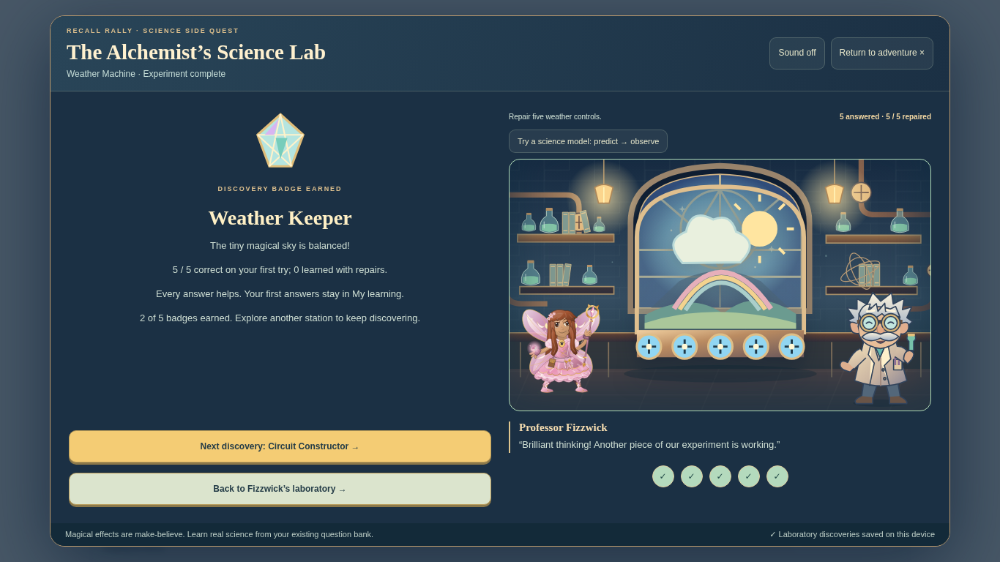

Completed Potion Mixer benchmark on unchanged main:

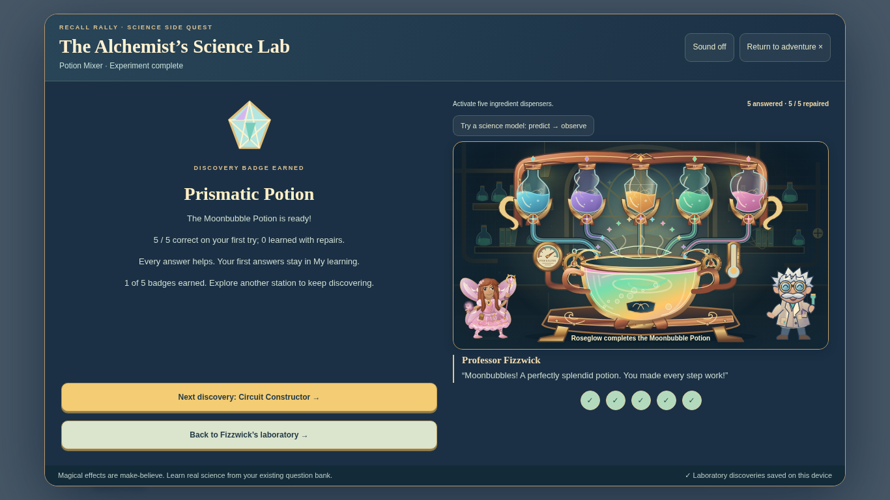

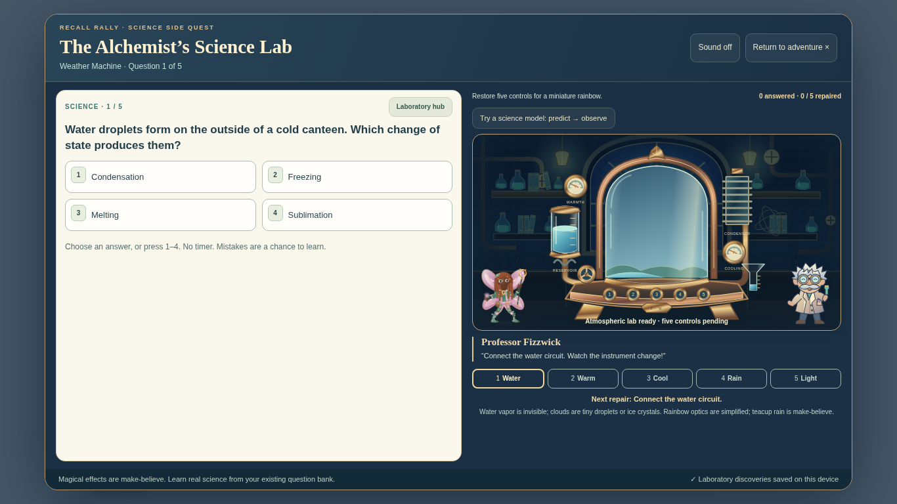

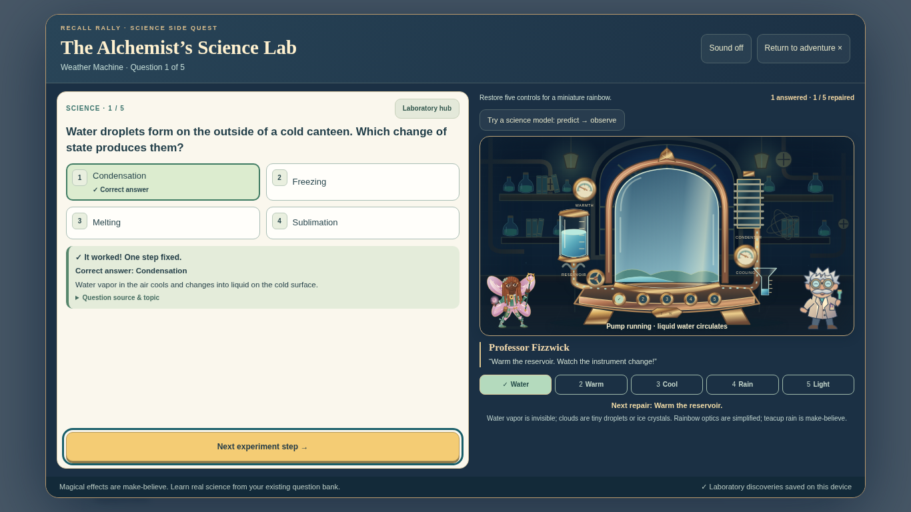

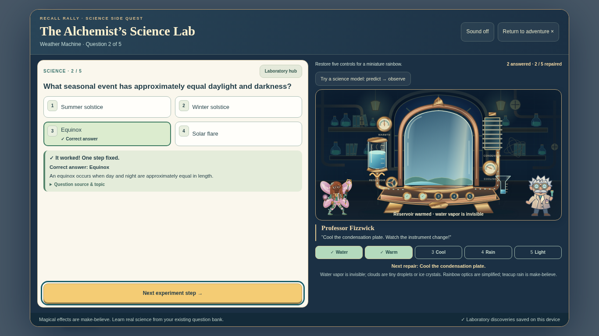

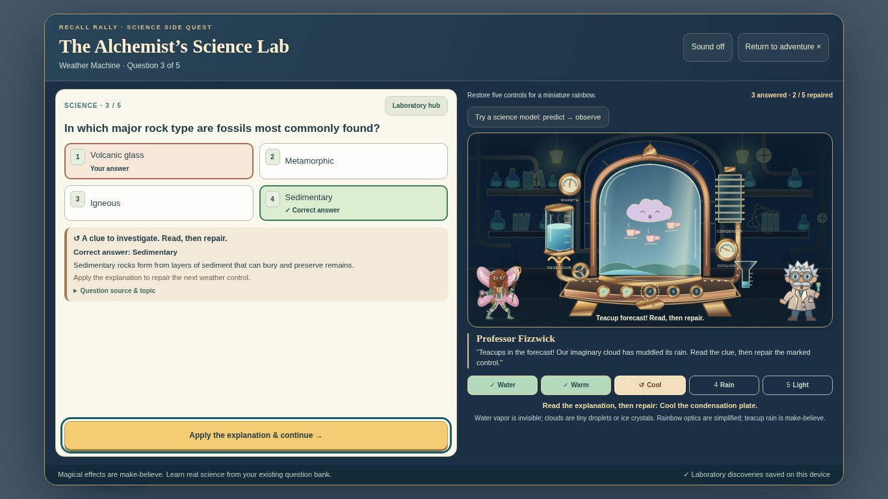

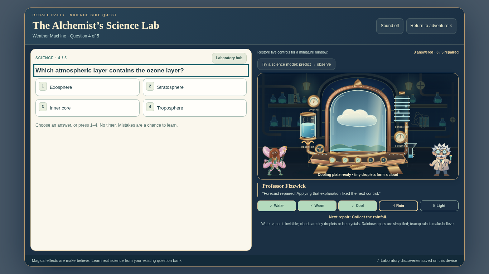

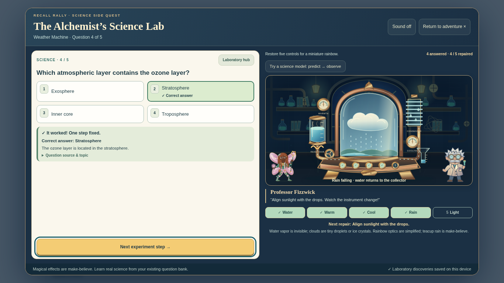

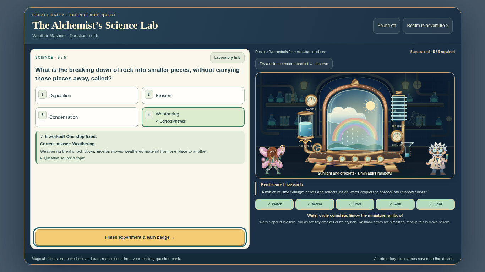

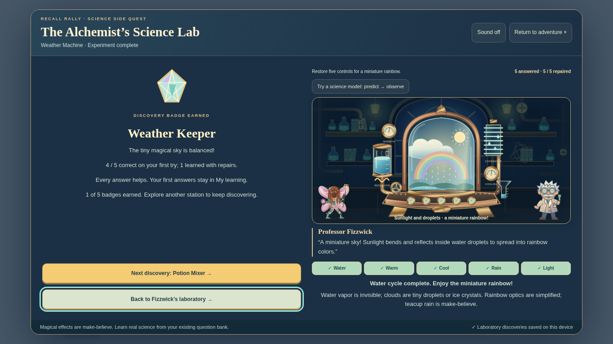

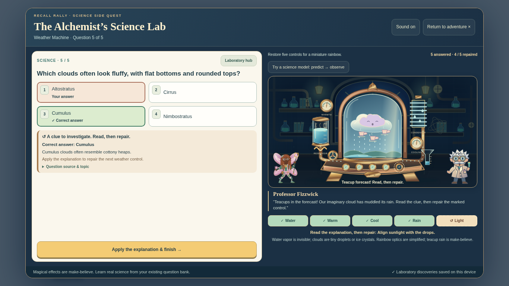

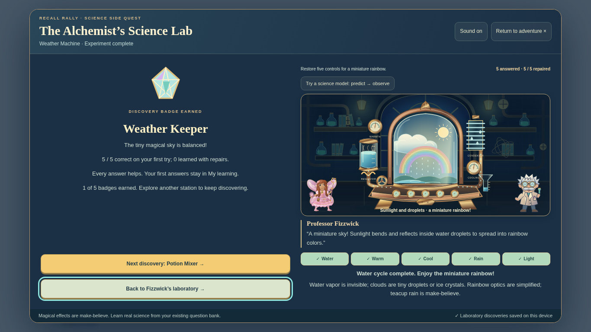

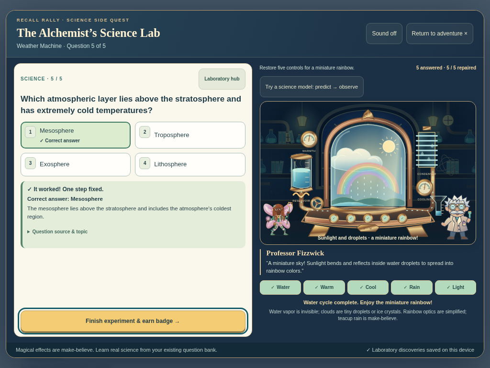

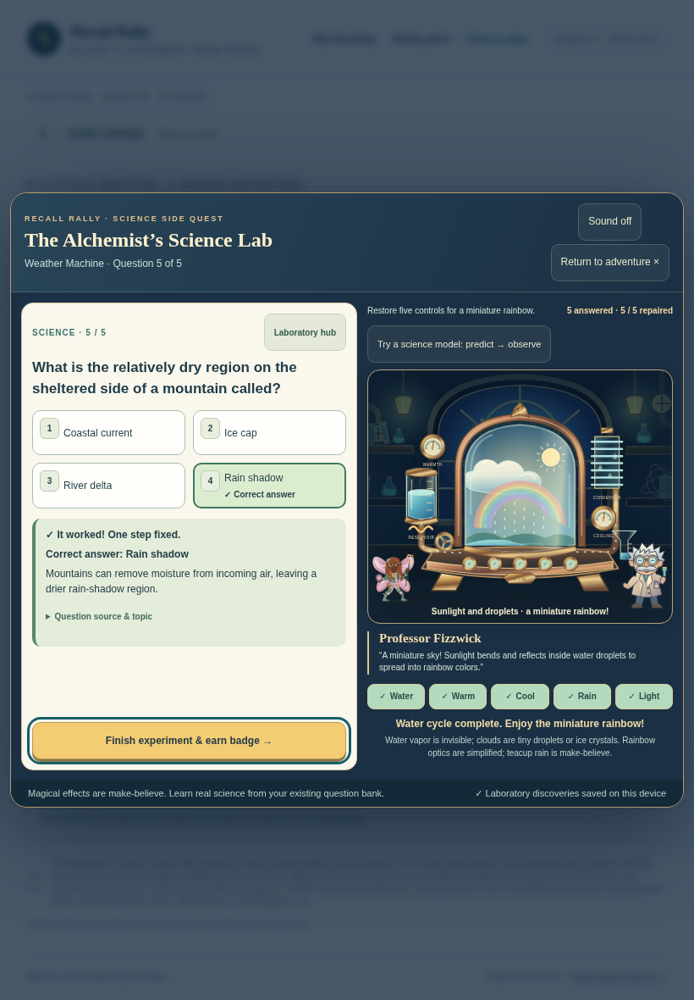

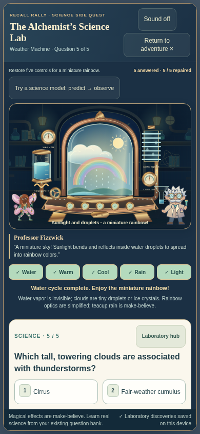

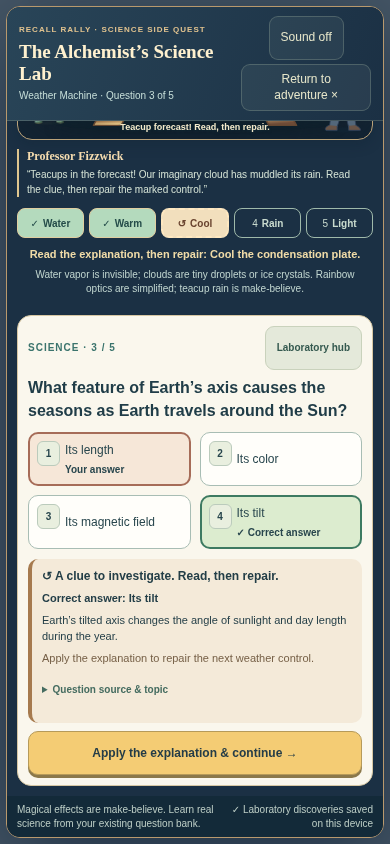

At 1366×768 and 1024×768, the apparatus, question, all choices, explanation, objective and Next fit in the viewport. Phone allows vertical scrolling and brings feedback/Apply into view after answering. Touch actions and controls stay reachable; no horizontal overflow. Screenshots are actual rendered game states, not concept art.

## Validation completed locally

- `node scripts/build-standalone.cjs` — regenerated both distributed HTML documents.
- `node tests/weather-art.test.cjs` — six equipment states, five independent repair markers, one ready control per repaired step, science-specific activation thresholds, final-only celebration, safe SVG identifiers/references, invalid inputs and exact module embedding in both HTML builds.
- `CHROMIUM_PATH=/usr/bin/chromium WEATHER_SCREENSHOTS=docs/reviews/weather-machine node tests/weather-browser.test.cjs` — **65 actual graded answers** at **1366×768, 1024×768, 820×1180 and 390×844**: mixed answers; final-step error/repair offline; all five steps missed/repaired offline at each viewport; plus a clean 5/5 standalone offline run. Checks real question IDs/prompts/options/explanations, first grades, duplicate-input protection, exactly one journal attempt per question, no academic attempt on repair, no premature finale, instrument/sky animation movement, keyboard and emulated touch, layout bounds, reduced motion, original optional science model, badge/history persistence, unchanged hero/Rigby progress and other-station isolation. No browser script errors.
- `CHROMIUM_PATH=/usr/bin/chromium node tests/science-lab-browser.test.cjs` — all five stations, shared bank/source records, badges/Prism, browser restart, profiles, eligible custom records, lab backup/import, offline play, save failures and the existing hero/Rigby seals passed.
- `CHROMIUM_PATH=/usr/bin/chromium node tests/science-lab-review.test.cjs` — all five science models, field notes, repairs, Prism persistence, source contrast, focus restoration and four viewport layouts passed.
- `CHROMIUM_PATH=/usr/bin/chromium node tests/potion-browser.test.cjs` — full benchmark regression at all four viewport sizes, including offline repair and reduced motion.
- `CHROMIUM_PATH=/usr/bin/chromium node tests/science-lab-static.test.cjs` — **every actual Amplify build command** passed in isolated staging. Played Circuit/model, Potion, Creature, and this station including a miss and repair in its real static output; four finales, 20 journal attempts, honest 4/5 result, Librarian launcher and unchanged Rigby progress.
- All current Amplify unit gates passed: this station, Creature/Circuit/Potion art, science lab, answer recognition, home launcher, adventure saves/effects, question bank, ten worlds and Librarian v4.
- `node scripts/check-science-lab-assets.cjs` — original local artwork dimensions, byte budgets, complete SVG and no scripts/remote resources passed. All **11 generated SVG states** (six progress states plus five mistakes) also parsed as XML. Script syntax and `git diff --check` passed.

The new `weather-art.yml` PR workflow repeats the artwork/browser checks and uploads gameplay screenshots. Amplify runs the new pure-art check. The test screenshot command can generate more states than the curated gallery committed here.

## Limits and next review

Automated Chromium with emulated touch viewports was tested; physical iPad/iPhone and Safari/Firefox remain untested. Offline tests load the self-contained HTML locally before disconnecting; direct file launch is not claimed as tested. No hosted preview URL or deployment is claimed.

The next useful check is the final sky transition and repair timing on a physical iPad. This is a **draft PR for review; do not merge into main**.
